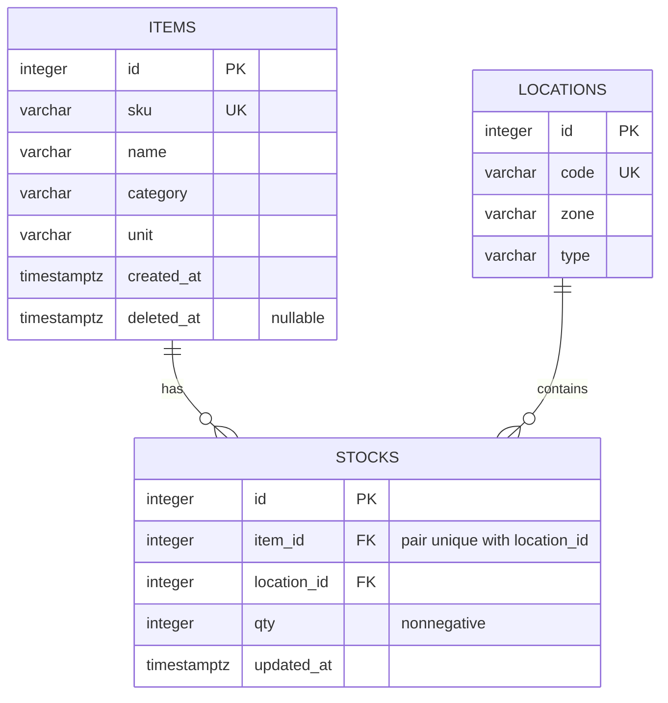
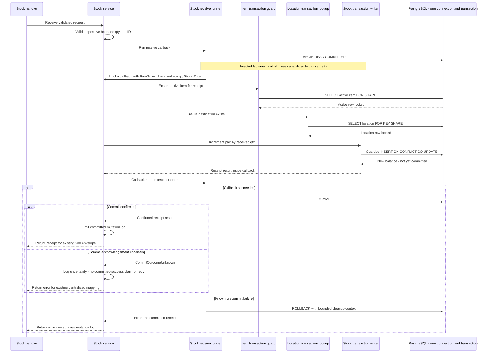
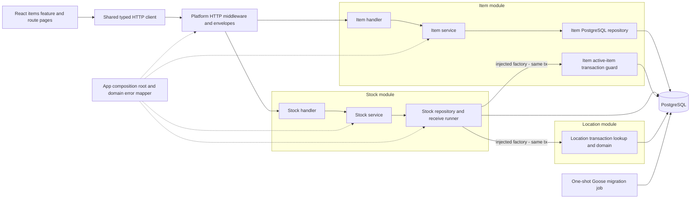

# Warehouse Item Management — Phase 01 Technical Design

Prepared: 14 October 2026, Asia/Jakarta. Status: Phase 01 design approved for Phase 02–03 implementation. Current implementation and verification status is recorded in README.md; later phases remain scheduled.

## 1. Executive summary and evidence

Build a small warehouse master-data and receiving application: seven REST endpoints, PostgreSQL persistence, and a React item list plus create/edit forms. Use Go + Gin + pgx/v5 with explicit SQL, Goose SQL migrations, React 19 + TypeScript + Vite, React Router v6, TanStack Query, Tailwind CSS, and Docker Compose. These are the user's selected technologies; Gin, pgx, Goose, Vite, and Tailwind are choices rather than PDF mandates.

Use a **domain-oriented modular monolith with layered architecture inside each business module**. Item and Stock each own their handler → service → repository → PostgreSQL flow and domain types. Location owns its domain representation and the transaction-bound persistence capability actually used by receiving; it has no unused handler/service. Shared infrastructure belongs under internal/platform, and internal/app explicitly constructs dependencies and registers routes. Frontend ownership is feature-based under src/features/items, with shared technical utilities and route-level pages outside the feature.

Database constraints enforce structural integrity; services enforce business invariants. Atomic stock upsert prevents lost updates. A short receive transaction also locks the active item to prevent a receive/soft-delete race. Item and Location adapters participate in **the same Stock-owned transaction**, using narrow injected contracts rather than separate service transactions. Application mutation logs meet the assessment; a durable movement ledger and idempotency remain future work. The refinement changes package ownership, not the database, API, or business behavior.

Selected small extensions: server-side SKU/name search and a category-options list in item-list metadata. They make the mandatory frontend work correctly across server-paginated data without another endpoint. No stock dashboard, location CRUD, stock transfer, authentication, Redis, or deployment is needed for the baseline.

### 1.1 Authoritative input and inspection

- Read all **five physical PDF pages**, including tables, simplification notes, README instructions, timeline, and submission format, from `Technical Test - Fullstack Compact.pdf` (original assessment supplied separately, not committed).
- The project workspace was empty at the initial Phase 01 inspection. No existing application, migrations, configuration, or applicable `AGENTS.md` was found in the workspace/checked ancestor directories.
- The installed Firecrawl CLI failed to connect for local parsing. Used the already available macOS PDFKit to extract every page locally; no dependencies were installed. Web verification succeeded through Firecrawl MCP, with some initial URLs requiring retries because of rate limits.
- PDF section numbers and physical pages below are the assessment evidence. The pasted Phase 01 brief adds design deliverables and review/testing expectations; it does not expand the PDF's mandatory product scope.
- The PDF estimates **3–5 hours backend and 3–5 hours frontend**. The submission limit is **two calendar days after actual receipt**. Receipt date/time and submission email address were not provided; do not derive them from filesystem timestamps or assume a precise deadline from today's date.

### 1.2 Classification and priority

**M** = mandatory PDF requirement; **O** = PDF optional enhancement; **X** = removed from mandatory PDF scope, not prohibited; **C** = submission constraint; **U** = user-selected stack or Phase 01 requirement; **D** = this document's proposed default/extension. **P0** = submission/core correctness; **P1** = mandatory usability/maintainability; **P2** = optional/future. Acceptance criteria describe future implementation, not checks already executed.

## 2. Requirement traceability matrix

### 2.1 Mandatory functional requirements

| ID / priority | Requirement | PDF page / section | Component | Acceptance criteria | Important edge cases |
|---|---|---|---|---|---|
| MF-01 / P0 | Item has id, sku, name, category, unit, created_at | p1 §1.2 A | DB/model/API | Persist and expose all six fields | Required text blank/null; identity and timestamp client injection |
| MF-02 / P0 | Location has id, code, zone, type | p1 §1.2 A | DB | Persist all four fields; make seeded locations usable | No mandatory location-management endpoint |
| MF-03 / P0 | Stock has id, item_id, location_id, qty, updated_at | p1 §1.2 A | DB/inventory | Quantities are associated with item and location | New pair; multiple locations |
| MF-04 / P0 | POST /api/v1/items creates item | p2 §1.2 B | Items | Valid create persists one item | Concurrent duplicate creates |
| MF-05 / P0 | GET /api/v1/items lists with category filter and pagination | p2 §1.2 B | Items | Correct filtered page and total | Empty result; page beyond last; malformed limits |
| MF-06 / P0 | GET /api/v1/items/:id returns detail | p2 §1.2 B | Items | Existing active item returned | Missing/deleted item; malformed ID |
| MF-07 / P0 | PUT /api/v1/items/:id updates item | p2 §1.2 B | Items | Persist valid submitted fields | Duplicate SKU; partial body; concurrent delete |
| MF-08 / P0 | DELETE /api/v1/items/:id soft-deletes item | p2 §1.2 B,C | Items | Set deleted_at, retain physical record | Repeated delete; retained stock |
| MF-09 / P0 | POST /api/v1/stock/receive receives into a location | p2 §1.2 B | Inventory | Add positive receipt to the correct pair | Missing references; concurrency; overflow |
| MF-10 / P0 | GET /api/v1/stock/:item_id checks all locations for item | p2 §1.2 B | Inventory | Return every existing stock pair for active item | Item with no stock; missing/deleted item |
| MF-11 / P0 | Unique SKU; duplicates return HTTP 409 | p2 §1.2 C | DB/errors | Create/update duplicates return field error and 409 | Concurrent writes; deleted SKU reuse |
| MF-12 / P0 | Stock cannot be negative; validate at service level | p2 §1.2 C | Service/DB | Service rejects invalid receipt before persistence; DB rejects invalid stock | Handler bypass; zero receipt policy is D |
| MF-13 / P0 | Every receive mutation has application console/file transaction log | p2 §1.2 C | Inventory/logging | Each successful receive logs IDs and quantity change | Rollback must not produce success log; commit uncertainty |
| MF-14 / P1 | Dashboard table/grid shows SKU, name, category, unit | p3 §2.1 | Frontend | All four fields visible | Empty results; long content |
| MF-15 / P1 | Frontend SKU/name search with debounce ≥300ms | p3 §2.1 | Frontend | Search applies after 300ms quiet time | Rapid typing; stale results; off-page match |
| MF-16 / P1 | Category dropdown filter | p3 §2.1 | Frontend | Selected category filters list | No categories; categories outside current page |
| MF-17 / P1 | Frontend pagination; client-side minimum, server-side if API supports | p3 §2.1 | Frontend | Page controls work against backend page/limit | Search/filter resets page; empty last page |
| MF-18 / P1 | Buttons navigate to Create/Edit item | p3 §2.1 | Frontend | Create and row edit routes open forms | Direct edit navigation; missing item |
| MF-19 / P1 | Form validates required SKU/name/category/unit | p4 §2.1 | Frontend | Invalid form does not submit and shows field errors | Whitespace-only input; edit defaults |
| MF-20 / P1 | Form calls create/update API | p4 §2.1 | Frontend | Successful submission persists intended item | 409 mapping; submit twice |
| MF-21 / P1 | Loading state while form request runs | p4 §2.1 | Frontend | Submit disabled with progress state | Preserve values on failure |
| MF-22 / P1 | Show success/error message from API response | p4 §2.1 | Frontend | API message and field errors displayed | Network error without API body |
| MF-23 / P1 | Skeleton or spinner during fetching | p4 §2.1 global | Frontend | Initial load and edit fetch show loading UI | Background refetch versus empty state |
| MF-24 / P1 | Toasts for successful/failed actions | p4 §2.1 global | Frontend | Mutations produce one appropriate toast | Avoid duplicate hook/page toasts |
| MF-25 / P1 | Responsive desktop 1280px+ and tablet 768px | p4 §2.1 global | Frontend | Usable list/form at both target widths | Table overflow; form controls |

### 2.2 Mandatory technical requirements and deliverables

| ID / priority | Requirement | PDF page / section | Component | Acceptance criteria | Important edge cases |
|---|---|---|---|---|---|
| MT-01 / P0 | Go preferred, or Java Spring Boot allowed | p1 overview; p2 §1.3 | Backend | This project uses Go | PDF allows Java; selected stack stays Go |
| MT-02 / P0 | PostgreSQL required | p2 §1.3 | DB | Real PostgreSQL used for persistence | No SQLite substitution for integration tests |
| MT-03 / P0 | Docker and Docker Compose | p2 §1.3 | Runtime | Containerized reproducible startup | DB readiness; persisted volumes |
| MT-04 / P0 | OpenAPI **3.0** documentation | p2 §1.3 | API docs | Valid OpenAPI 3.0.3 covering seven operations | Swagger 2.0 generator output is insufficient |
| MT-05 / P0 | Handler/controller → service → repository | p2 §1.3 | Backend | HTTP, business, persistence responsibilities separated | SQL/business logic inside handlers |
| MT-06 / P1 | Request logging middleware | p2 §1.3 | HTTP | Method/path/status/duration logged | Panic and early validation rejection |
| MT-07 / P0 | Centralized error handling middleware | p2 §1.3 | HTTP | One status/envelope mapping path | Default Gin binding/recovery bypassing envelope |
| MT-08 / P0 | Standard success/error response envelope | p2 §1.3; p3 §1.4 | HTTP/frontend | success/message/data and relevant meta; errors array on failure | Unknown routes; invalid JSON; DELETE body |
| MT-09 / P0 | Handler input validation before service | p3 §1.3 continued | HTTP | Invalid body/path/query rejected without service call | Missing qty versus zero; trailing JSON |
| MT-10 / P0 | Environment configuration; no hardcoded credentials | p3 §1.3 continued | Config/runtime | Env drives DB and runtime; secrets absent from tracked code | Missing/malformed env; DSN leaks |
| MT-11 / P0 | Database migration scripts, plain SQL/tool allowed | p3 §1.3 | Migrations | Empty DB upgraded with versioned Goose SQL | Existing DB; rollback dependencies |
| MT-12 / P0 | React 18/19 with TypeScript | p4 §2.2 | Frontend | Selected React 19, typed source compiles | Compatible pinned dependency versions |
| MT-13 / P1 | React Router v6, at least list and create/edit routes | p4 §2.2 | Frontend | Three proposed routes render and support direct load | SPA fallback in container |
| MT-14 / P1 | TanStack Query | p4 §2.2 | Frontend | Queries/mutations managed through QueryClient | Filter keys and invalidation |
| MT-15 / P1 | Custom hooks separate logic | p4 §2.2 code quality | Frontend | useItems/useItem/useItemMutations contain query logic | useStock is an example, not mandatory UI |
| MT-16 / P1 | Modular single-responsibility components | p4 §2.2 | Frontend | Form/table/filter/feedback components separated | Avoid one giant page component |
| MT-17 / P1 | TypeScript types/interfaces for all API data | p4 §2.2 | Frontend | Item, stock, envelope, metadata and errors typed | Type assertions do not validate runtime data |
| MD-01 / P0 | Backend source in GitHub repository | p3 §1.5 | Submission | Reviewer can access full source | p5 permits public or reviewer invite; public selected |
| MD-02 / P0 | docker-compose.yml starts with docker compose up --build | p3 §1.5; p5 §3.4 | Runtime | Documented command starts healthy usable application | Fresh clone/no .env; migration failure |
| MD-03 / P0 | OpenAPI file or /docs access | p3 §1.5 | Docs | backend/docs/openapi.yaml shipped | Interactive Swagger UI is optional |
| MD-04 / P0 | Migration scripts shipped | p3 §1.5 | Migrations | SQL source included under backend/migrations | Seed discoverability |
| MD-05 / P0 | .env.example provided | p3 §1.5 | Config/docs | backend/.env.example describes required/default vars | Templates contain only local sample values |
| MD-06 / P0 | README required | p3 §1.5; p5 §3.2 | Docs | Project/architecture, backend/frontend/Docker setup included | Local DB host differs from Compose host |
| MD-07 / P0 | README ≥2 technical decisions with trade-offs | p5 §3.2 | Docs | Explain upsert and layered SQL approach at minimum | Candidate can defend decisions |
| MD-08 / P0 | Honest AI usage disclosure | p1 AI note; p5 §3.2 | Docs/submission | Name tools, AI-assisted areas, independently written areas | Do not fabricate human-only authorship |
| MD-09 / P0 | Frontend in /frontend of same repo | p4 §2.3 | Repository | Frontend source and package.json committed | No disconnected second repository |
| MD-10 / P0 | npm install && npm run dev supports local frontend | p4 §2.3 | Frontend/docs | Works from frontend with documented API setup | Vite proxy/local API URL |
| MD-11 / P0 | Required repository layout | p4 §3.1 → p5 | Repository | backend cmd/internal/migrations/docs/Dockerfile/.env.example; frontend src components/hooks/pages/types/services; root Compose/README | Proposed root docs is an additive design artifact |

### 2.3 Optional enhancements, removed features, constraints, and evaluation guidance

| ID / priority | Classification and requirement | PDF reference | Component | Acceptance / interpretation | Edge case |
|---|---|---|---|---|---|
| OP-01 / P2 | O: Redis cache | p2 §1.3 | Backend | Defer; no required behavior depends on it | Cache invalidation adds risk |
| OP-02 / P2 | O/X: /stock/transfer and /locations endpoints | p2 §1.2 simplification | Backend | Explicitly removed from baseline; permitted bonus | Do not invent location API requirement |
| OP-03 / P2 | O/X: item/stock detail page and global error boundary | p4 §2.1 simplification | Frontend | Defer both; backend item detail endpoint remains required | Edit still fetches item detail |
| OP-04 / P2 | O: Vercel/Netlify frontend deployment and URL | p4 §2.3; p5 §3.2 | Submission | Defer until all mandatory checks pass | Hosted frontend needs reachable backend |
| OP-05 / P2 | Conditional fallback: Platzi Fake Store API | p3 §2 | Frontend | Only if backend unfinished; Item→Product, Location→Category; disclose substitution | Do not mix schemas silently |
| SC-01 / P0 | C: ≤2 calendar days after receipt | p5 §3.3 | Delivery | Confirm actual receipt and reviewer interpretation of cutoff | Calendar days are not necessarily 48 hours |
| SC-02 / P0 | C: repository public or reviewer invited before deadline | p5 §3.3 | Delivery | Choose public repo, satisfying p3 and p5 | Private alternative needs completed invite |
| SC-03 / P0 | C: email subject [Technical Test] Fullstack – [Nama Kandidat] | p5 §3.3 | Delivery | Use specified subject with actual candidate name | Recipient/name absent from available material |
| EG-01 / P1 | Guidance: explain generated code and design trade-offs | p1 AI note; p5 §3.4 | Review/docs | Candidate reviews and understands every submitted part | AI output is not evidence of correctness |
| EG-02 / P1 | Guidance: prioritize error handling, clear README, comments on non-obvious logic | p5 §3.4 | All | Explain locks/transaction policy; avoid half-finished bonuses | Popular stack does not prove production readiness |
| EG-03 / P1 | Guidance: clean, structured, production-oriented output | p1 AI note | All | Meet concrete reliability checks in this design | No claim of production readiness without operations evidence |

**No product feature is expressly forbidden by the PDF.** X means removed from mandatory scope. Authentication, authorization, analytics, CI, tests, ledger, and idempotency are not stated PDF mandates. This user's brief requires a test strategy and design review, and forbids implementation during Phase 01. The only project file created in this phase is this document.

## 3. Scope, non-goals, and implementation budget

Baseline: item CRUD with soft deletion, category-filtered pagination, location seed data, receive and stock lookup, standardized API/errors/logs, two frontend screen types, Docker, migrations, OpenAPI, README/AI disclosure, and high-value tests requested by the user.

Deliberately avoid microservices, message brokers, CQRS, event sourcing, generic CRUD frameworks, repository-per-table boilerplate, dependency-injection generators, ORM replacement, SQL generation setup, database triggers for business workflow, external telemetry, and caching. A single backend process and PostgreSQL solve the required consistency problem.

Predictable extension by new business modules is an explicit architectural goal. Here modularity means cohesive Go packages, narrow contracts, constructor injection, and explicit route registration; it does not mean runtime loading or separate deployments. Future Supplier/Purchase capabilities can be added without redistributing Item/Stock files. UI menus are presentation choices, not backend module boundaries: one screen may use several modules, and a module such as Location may have no navigation entry.

Future/bonus only: movements ledger, idempotent receipts, transfers, location administration, frontend inventory details/receive UI, frontend delete control, error boundary, authentication, rate limits, Redis, deployment. Backend DELETE remains mandatory even when the frontend has no delete button.

Do not silently remove selected search/category metadata extensions when implementing: if dropped for time, choose an explicit complete client-side dataset strategy and revise the contract. Filtering only the current server page does not meet a useful search expectation.

## 4. Domain model and business decisions

Item is master data; Location is a physical rack/zone identifier; Stock is the quantity of one item at one location. Item 1→0..N Stock; Location 1→0..N Stock. Item and Location are many-to-many through Stock. One Stock belongs to exactly one Item and one Location. Creating an item does not create stock rows.

| Question | PDF specifies? | Recommended decision (D unless specified) | Reason and implementation implication |
|---|---|---|---|
| Can an item exist without stock? | Not explicitly | Yes | CRUD is separate from receiving; lookup returns stocks: [] |
| Multiple locations per item? | Yes in effect: stock per location, all-location lookup | Yes | Model stock pairs rather than item.qty |
| Multiple items in one location? | Not explicit | Yes | Do not make location_id alone unique |
| Unique (item_id, location_id)? | Not explicit | Yes | Avoid duplicate balances and provide conflict target |
| Receive references nonexistent item? | Not explicit | Reject 404 item_id | No implicit item creation; FK backs existence |
| Receive soft-deleted item? | Not explicit | Reject 404 item_id | Treat inactive item as unavailable; lock active check with FOR SHARE |
| Does deletion change existing stock? | Only soft delete specified | Retain stock unchanged; allow deletion even with stock | Preserve data without adding a zero-stock deletion rule; exclude deleted items from public stock lookup |
| Does deleted SKU remain reserved? | Unique SKU required, reuse unspecified | Current SKU remains reserved globally | Ordinary unique constraint covers deleted rows; no partial SKU index. Renaming an active SKU releases its previous value; historical SKU reservation is not implemented |
| Duplicate detection/mapping? | 409 explicitly | Named unique constraint is authoritative; map 23505 + items_sku_key | Prechecks alone race; update to same SKU succeeds |
| Two concurrent receives? | Not explicitly detailed | Both distinct receipts accumulate | Atomic SQL increment; pair unique; transaction described in §6 |
| Integer or decimal qty? | Type unspecified | Whole-unit 32-bit integer, 0..2,147,483,647 stored | Simple exact arithmetic and JSON-safe numbers; fractional receiving not supported. Weight/volume fractions would require numeric + decimal contract revision |
| Zero/negative receive? | Negative stock forbidden, receipt sign unspecified | Require integer qty ≥1 | Receiving means positive addition; service repeats validation; cumulative maximum guarded atomically |
| Retry after timeout? | Not specified | No automatic receive retry; explain uncertain outcome | Two identical requests are two receipts without an idempotency key; reconcile before retry |
| Populate locations? | Entity required; /locations removed | Migration seeds two deterministic demo locations | Stable codes; DB-generated IDs; README query discovers IDs; no new endpoint |

Further defaults: IDs are positive 32-bit integers. Persisted text fields trim surrounding ASCII spaces (U+0020), are case-sensitive for uniqueness/category equality, and reject Unicode whitespace-only values and ASCII control characters (U+0000–U+001F and U+007F). Tabs/newlines in item fields are rejected, not silently removed. Other Unicode text is permitted without automatic Unicode normalization. SKU is **not** automatically uppercased; `abc` and `ABC` are distinct. Search is case-insensitive. Names need not be unique. Categories/units are free text, not new entities or enumerations. Location type is free text without new business rules. PUT replaces all four editable fields; ID/created_at/deleted_at are server-owned. Concurrent item edits are last-committed-write wins; optimistic versioning is future work. No undelete or hard-delete API.

## 5. PostgreSQL database design

### 5.1 ERD



Table names are plural persistence names; API entity Stock is unchanged. Only these three tables plus Goose's version table are baseline.

### 5.2 Column and constraint specification (design, not migrations)

| Table.column | PostgreSQL type | Null/default | Constraint / purpose |
|---|---|---|---|
| items.id | integer GENERATED ALWAYS AS IDENTITY | NOT NULL/generated | PK; positive-ID check |
| items.sku | varchar(64) | NOT NULL/no default | Named global UNIQUE items_sku_key; nonblank, trimmed, control-free check |
| items.name | varchar(200) | NOT NULL/no default | Nonblank, trimmed, control-free check |
| items.category | varchar(64) | NOT NULL/no default | Nonblank, trimmed, control-free check |
| items.unit | varchar(32) | NOT NULL/no default | Nonblank, trimmed, control-free check |
| items.created_at | timestamptz | NOT NULL/now() | Database-generated creation time |
| items.deleted_at | timestamptz | NULL/default NULL | Active iff NULL; no boolean deletion flag |
| locations.id | integer GENERATED ALWAYS AS IDENTITY | NOT NULL/generated | PK; positive-ID check |
| locations.code | varchar(64) | NOT NULL/no default | Named UNIQUE locations_code_key; nonblank/trimmed/control-free |
| locations.zone | varchar(64) | NOT NULL/no default | Nonblank/trimmed/control-free |
| locations.type | varchar(32) | NOT NULL/no default | Nonblank/trimmed/control-free; no enum required |
| stocks.id | integer GENERATED ALWAYS AS IDENTITY | NOT NULL/generated | PK; positive-ID check |
| stocks.item_id | integer | NOT NULL/no default | FK items.id; ON DELETE RESTRICT; ON UPDATE RESTRICT |
| stocks.location_id | integer | NOT NULL/no default | FK locations.id; ON DELETE RESTRICT; ON UPDATE RESTRICT |
| stocks.qty | integer | NOT NULL/default 0 | Named CHECK stocks_qty_nonnegative: qty ≥0; storage max 2,147,483,647 |
| stocks.updated_at | timestamptz | NOT NULL/clock_timestamp() | Explicitly set on each receive; no implicit automatic update |

Named `stocks_item_location_key` is a nondeferrable UNIQUE(item_id, location_id). Constraint names are part of repository error mapping. Required-text DB checks enforce nonempty text, equality with ASCII-space-trimmed text, and absence of ASCII controls; handler/service additionally reject Unicode whitespace-only strings using the explicit §4 policy. PostgreSQL rejects NUL; API validation rejects it earlier. Database checks are structural backstops, not a substitute for the stricter service validation. No extension is required for IDs or schema.

Use timestamptz throughout and render API timestamps as UTC RFC3339 strings. `clock_timestamp()` represents stock statement time after any lock wait; a transaction-start timestamp could appear older than an earlier committed receipt. Do not use timestamps as stock version numbers.

Global SKU uniqueness persists after deletion. Foreign keys ensure physical existence, **not active status**: PostgreSQL cannot enforce deleted_at state through an ordinary FK. The receive service transaction supplies that rule. No cascading deletion or stock zeroing. Keep DB data even if hidden in active-item API views.

### 5.3 Indexes justified by actual queries

| Index | Why | Decision |
|---|---|---|
| Three primary-key indexes | Item/location lookup and row identity | Automatically created; no duplicates |
| items_sku_key unique index | Required SKU uniqueness on create/update | Global, including deleted records |
| locations_code_key unique index | Stable seed identity and operator discovery | Proposed low-cost location consistency |
| stocks_item_location_key unique index | Receive conflict target; all-stock-by-item via leftmost item_id | No extra stocks(item_id) index |
| Partial items(category, id) WHERE deleted_at IS NULL | Category-filtered active list ordered by id; distinct active categories | Recommended for explicit mandatory query |

Use `ORDER BY id ASC` with offset pagination. Unfiltered listing can use the item PK and filter inactive records; avoid another speculative index for the small dataset. A dedicated stocks(location_id) index is unnecessary without location queries or location deletion; FKs do not automatically create referencing-side indexes. Case-insensitive substring search will scan the small active dataset: do not add pg_trgm or full-text infrastructure. Revisit with measured plans/data only.

### 5.4 Migration and seed plan

1. `00001_create_items_locations_stocks.sql`: create items/locations before stocks; named checks/FKs/unique constraints/index; reversible Down drops stocks first, then locations/items.
2. `00002_seed_locations.sql`: seed `RACK-A1 / A / rack` and `RACK-B1 / B / rack`, using code as stable identity. IDs are generated rather than assumed to be 1/2. A code-conflict no-op makes demo seeding safe without overwriting existing location metadata. README discovery query lists id/code/zone/type. Do not seed items or stock in mandatory runtime migrations; tests own their fixtures.

Goose SQL uses Up/Down annotations and transactions by default, as documented in [Goose](https://github.com/pressly/goose). Execute ordinary schema/index work transactionally; no concurrent index creation needed. Pin the CLI version later; app uses pgxpool directly, migration job uses Goose CLI's PostgreSQL driver, avoiding unnecessary application database/sql adapters.

Seed Down is only supported in a disposable demo/test DB known to have been empty before seeding. There it removes unchanged demo records by code when unreferenced; if referenced or altered, fail clearly and leave migration state unchanged rather than deleting business stock. A code-conflict no-op does not prove that a preexisting row belongs to this migration, so do not run seed Down on a populated/shared database; use a forward corrective migration instead. Schema Down is destructive and restricted to disposable local/test DBs. Never auto-rollback on application startup. Test up → down → up on an empty disposable DB plus seed rollback refusal with referenced locations.

Compose should have db → one-shot migrate → backend → frontend dependencies. Database health gates migration; successful migration exit gates backend. Goose is the only runtime migration owner, preventing duplicate startup migration paths. Preserve named data volume on ordinary restarts.

### 5.5 Optional movement ledger

Do **not** implement `stock_movements` in the assessment baseline. Application logging is explicitly sufficient in PDF p2 §1.2 C. A ledger adds migration, write path, failure tests, and retention questions without required UI/use cases.

Future proposal: append-only movement ID, item_id/location_id FKs, signed delta, resulting_qty, receive operation type, occurred_at, request ID, optional idempotency reference. Write balance and movement in the **same transaction**, commit together, fail both if either write fails. A ledger does not itself deduplicate receipts. A transactional outbox would only become relevant if durable external publication is needed; it is not proposed now.

## 6. Stock receiving: concurrency, transactions, and retries

### 6.1 Lost-update failure and selected atomic operation

Naive algorithm: A reads 10; B reads 10; A calculates 15; B calculates 15; both write 15. One valid receipt disappears. An in-process mutex would not protect multiple backend processes or direct DB clients.

Selected **conceptual repository SQL**, to be implemented only in a later phase:

```sql
INSERT INTO stocks (item_id, location_id, qty, updated_at)
VALUES ($1, $2, $3, clock_timestamp())
ON CONFLICT (item_id, location_id) DO UPDATE
SET qty = stocks.qty + EXCLUDED.qty,
    updated_at = clock_timestamp()
WHERE stocks.qty <= 2147483647 - EXCLUDED.qty
RETURNING id, item_id, location_id, qty, updated_at;
```

`$3` has already passed handler and service integer/positive/maximum checks. The overflow predicate operates under the stock row lock. A conflict with insufficient capacity updates no row and returns no row; repository converts that to stock-capacity conflict (409), not missing item. Do not compute the new balance in application code. `qty_after` is returned by the write; `qty_before = qty_after - received_qty` is safe for logging that specific receipt, without a racing read.

PostgreSQL documents an atomic insert-or-update outcome for ON CONFLICT DO UPDATE under concurrency, and the conflict expression reads the actual stock row. The pair's unique constraint is essential for both deduplicating balance rows and selecting the conflict target. See [PostgreSQL 17 INSERT](https://www.postgresql.org/docs/17/sql-insert.html). This source guarantees atomicity; our positive quantity and capacity policies are design recommendations.

Existing balance: A upserts +5 and locks the stock row, obtains 15; B waits; after A commits, B increments the latest balance to 20. New balance: A inserts 5, while B's insertion competes for the same unique pair; after A commits B takes the conflict update path and obtains 10. If A rolls back, B can insert 5. Exactly one balance row survives.

### 6.2 Explicit transaction boundary and deletion race

The upsert alone is atomic and would not need an explicit transaction if it were the only operation. Here receiving also requires a race-safe active-item check and clear reference validation, so use **READ COMMITTED** with one short transaction:

1. Service rejects invalid item_id, location_id, qty before beginning work, even when invoked without HTTP.
2. Begin transaction through an inventory-specific repository transaction runner; defer bounded rollback immediately.
3. Read `items` with `id = requested_id AND deleted_at IS NULL FOR SHARE`. If absent, return item-not-found and roll back.
4. Read requested location with `FOR KEY SHARE`; if absent, return location-not-found and roll back. This also guards physical removal while receiving. Locations have no delete API, but FK integrity remains a backstop.
5. Execute the guarded upsert and map known persistence errors; keep returned balance private until commit.
6. Commit; only after confirmed success emit `stock.receive.committed`, then return 200.
7. On any precommit failure roll back and emit no committed-mutation log. Release rows/connections in every path.

`FOR SHARE` allows simultaneous receipt validations on one item, but conflicts with updates to that row, including soft deletion. `FOR KEY SHARE` on the **item** would be insufficient: a non-key deleted_at update can proceed under that weaker lock. Lock relationships are verified in [PostgreSQL 17 explicit locking](https://www.postgresql.org/docs/17/explicit-locking.html).

DELETE uses one atomic update with `WHERE id = requested_id AND deleted_at IS NULL`, setting deleted_at and returning the deleted row. If receiving obtained its item lock first, deletion waits for the committed receipt, then marks the item inactive. If deletion obtained its update lock first and commits, receiving waits/rechecks active eligibility and returns 404. The valid order is therefore receive-before-delete or delete-before-rejected-receive. Stock is retained in either case. Item edits also briefly wait on the share lock, an acceptable trade-off for this scale.

Always acquire locks in item → location → stock order. Do not perform network calls, frontend work, or log shipping while holding locks. Distinct stock pairs can update independently; receipts for the same pair naturally serialize. No global locks, serializable isolation, Redis locks, or Go mutex are needed.

```mermaid
sequenceDiagram
    participant A as Request A (+5)
    participant B as Request B (+5)
    participant PG as PostgreSQL (qty 10)
    A->>PG: BEGIN; active item FOR SHARE; location FOR KEY SHARE
    B->>PG: BEGIN; compatible reference locks
    A->>PG: UPSERT qty = qty + 5
    PG-->>A: qty 15 (stock row locked)
    B->>PG: UPSERT qty = qty + 5 (waits)
    A->>PG: COMMIT
    PG-->>B: qty 20 (latest committed balance)
    B->>PG: COMMIT
    A-->>A: Log confirmed mutation; respond 200
    B-->>B: Log confirmed mutation; respond 200
```

### 6.3 Rollback, cancellation, and uncertain commit

Validation/missing references/capacity/database statement failure before commit leave quantities unchanged. PostgreSQL aborts the failed transaction; the caller still must finalize it. pgxpool documentation explicitly states that cancellation does **not** automatically roll back a started transaction; Commit/Rollback must be called. Use a separate short cleanup context for deferred rollback when the request context is already canceled. See [pgxpool transaction documentation](https://pkg.go.dev/github.com/jackc/pgx/v5/pgxpool#Pool.BeginTx).

If transport fails while COMMIT is being acknowledged, the client/server may not know whether commit completed. Rollback cannot undo a commit that already succeeded. Log `stock.receive.commit_unknown` with request/pair/delta rather than falsely declaring either committed or rolled back; return a client-safe failure if the connection still allows a response. A timeout is not proof that nothing changed. Do not retry this receipt automatically.

### 6.4 Concurrency versus idempotency

Concurrency safety applies **both distinct requests** (+5 and +5) exactly once each if they succeed. Idempotency recognizes **one logical receipt resent twice** and applies it once. The baseline has concurrency safety but **does not guarantee idempotency**. Two successful identical POSTs add twice. Request IDs are correlation IDs, not deduplication keys. TanStack mutations explicitly disable retries; README/OpenAPI warn that receive must be reconciled after an uncertain result.

Stripe verifies the value of request keys and checking reused-key parameters; AWS explains why timeout retries can repeat effects. See [Stripe idempotent requests](https://docs.stripe.com/api/idempotent_requests), [AWS retry-safe APIs](https://aws.amazon.com/builders-library/making-retries-safe-with-idempotent-APIs/). Deferring this mechanism for the assessment is **our deadline-based choice**, not either source's recommendation.

Future design if needed: require an Idempotency-Key for receive; store a unique endpoint/key record, canonical validated payload fingerprint and committed response in the same DB transaction as the stock update. Same key/payload replays prior success; changed payload returns 409; concurrent same-key requests wait/replay through DB uniqueness. Define retention and failure behavior before implementation. Avoid caching failures from an aborted stock transaction as if committed. An in-memory map, button disablement, or payload equality without a key does not provide durable idempotency.

### 6.5 Module interaction within the receive transaction

The following adapts the existing inventory-specific transaction runner to module ownership; every step and SQL/lock policy in §§6.1–6.4 remains unchanged. Stock service consumes narrow transaction-session contracts; the runner lives in modules/stock/repository/postgres. internal/app injects factories that construct Item's active-item guard and Location's lookup against the **runner's exact pgx.Tx**. These factories do not acquire a pool connection or begin another transaction. Detailed ownership/import rules are in §8.5.



Item soft deletion continues using Item's own atomic active-row update; PostgreSQL's existing lock conflict supplies the cross-module ordering. A pooled ItemService.Get followed by a separately begun stock transaction would reopen the deletion race and is expressly excluded. Conceptual module boundaries do not divide this database transaction.

## 7. REST API contract

### 7.1 Shared types and validation policy

Base path `/api/v1`; JSON requests/responses; snake_case fields; UTC RFC3339 timestamps. JSON IDs and quantities are integers in the safe 32-bit range. Item response contains id/sku/name/category/unit/created_at, omitting deleted_at in active views. Stock response contains id/item_id/location_id/qty/updated_at; lookup also embeds location id/code/zone/type for usability.

Input ItemWrite contains exactly sku, name, category, unit. Required non-null strings follow §4 normalization: trim ASCII spaces, reject blank/control characters, enforce 64/200/64/32 Unicode-character maxima respectively. Handler validates before calling service; service repeats relevant normalized/domain validation so alternate callers cannot violate invariants. Frontend uses the same text-field rules. The length limits/case policies are D, not PDF requirements. No user-provided stock balance or server-owned item fields.

Parse path IDs as positive base-10 integers within 2,147,483,647; malformed/zero/negative/overflow IDs return 400. Reject malformed JSON, wrong types, unknown body fields, null/missing required fields, multiple JSON documents/trailing garbage, and bodies over 64 KiB (413 D, same error envelope). JSON write requests require application/json (415 D). Business validation errors use 400 throughout; **do not introduce 422** for the same error class. `qty` is a delta, never a replacement balance; integer qty 1..2,147,483,647 is required.

Success envelope always has success:true, message:string, data:value. Add meta for item pagination only. Error envelope always has success:false, message:string, errors:array of {field,reason}; use field `request` for non-field errors. Arrays are [] rather than null. Return API error messages safe for display; do not expose SQL/DSNs/stack traces. All handlers, validation, unknown API paths/methods, and panic recovery use these helpers. No 204 response for DELETE because an envelope is required.

| Status | Mapping | Example safe error |
|---|---|---|
| 400 | Invalid JSON/path/query/field or invalid service quantity | Validation failed; qty must be a positive integer |
| 404 | Missing/deleted item, missing receive location, unknown API route | Item not found / Location not found |
| 405 (D) | Known API path with unsupported method | Method not allowed; include Allow header |
| 409 | Duplicate SKU **mandatory**; proposed cumulative stock capacity conflict | SKU already exists / Stock quantity limit exceeded |
| 413 / 415 (D) | Body cap / unsupported write media type | Request body too large / Content type must be application/json |
| 422 | Not selected | Avoid inconsistent split of field validation statuses |
| 500 | Unexpected internal persistence/application failure; panic; uncertain commit if response possible | Internal server error |
| 503 (D) | Known DB unavailability or operation deadline exceeded before known completion | Service temporarily unavailable; do not advise automatic receive retry |

If the caller disconnects, cancellation may prevent any HTTP response; log cancellation without pretending an envelope was delivered. A 500/503 from receive is not an idempotent retry promise.

### 7.2 POST /api/v1/items

Purpose: create master data independently of stock. No query/path parameters. Body: required ItemWrite. Validation as §7.1; no create-on-conflict.

Request example:

```json
{"sku":"WH-001","name":"Storage Box","category":"Packaging","unit":"pcs"}
```

201 Created; include Location: /api/v1/items/1. Successful response example:

```json
{"success":true,"message":"Item created successfully","data":{"id":1,"sku":"WH-001","name":"Storage Box","category":"Packaging","unit":"pcs","created_at":"2026-10-14T07:00:00Z"}}
```

Errors: 400 validation, 409 duplicate (including deleted SKU), 413/415 request format, 500/503 shared failures. Concurrent duplicate creates: one 201, one 409; DB uniqueness is authoritative. A request timeout followed by retry may yield 409 after the first commit; creation does not acquire receive-style idempotency.

Duplicate response example, shared with PUT:

```json
{"success":false,"message":"SKU already exists","errors":[{"field":"sku","reason":"Duplicate entry"}]}
```

### 7.3 GET /api/v1/items

Purpose: list active item master data. No body. Query contract:

| Parameter | Requirement basis | Validation/default | Behavior |
|---|---|---|---|
| category | M: PDF p2 | Optional string, trimmed, max 64; empty means all | Exact case-sensitive match |
| page | M: pagination; name/default D | Integer ≥1, default 1; validate offset multiplication/range | Offset = (page−1)×limit; reject offset above signed 32-bit range with 400 |
| limit | M: pagination; name/default D | Integer 1..100, default 10 | Do not silently clamp invalid values |
| q | **D extension**, frontend search is M | Optional trimmed string, max 200; empty disables | Case-insensitive literal substring of sku OR name |

Combine category AND (SKU/name search). Bind all SQL parameters. Escape `%`, `_`, and the escape character for literal ILIKE semantics; SQL parameterization prevents injection but does not disable wildcard interpretation. No sort/include_deleted parameters. Reject unknown/duplicate query keys with 400 to avoid ambiguous requests.

Use stable id ASC ordering; count total after filters, before pagination. Execute rows, count, and categories in one short read-only REPEATABLE READ transaction for a consistent response snapshot. Close result rows before subsequent queries/commit. Offset pagination does not promise a frozen dataset across separate requests; deletion/insertion can shift pages. No need for cursor tokens at this size.

**D extension `meta.categories`:** sorted distinct category strings across all active items, independent of current category/q/page. This provides complete dropdown options without another endpoint or fetching every page. Empty dataset yields []. Form inputs remain free text. Include selected category locally if it disappeared while browsing so the UI can show/clear an empty filter.

200 OK example for `?category=Packaging&page=1&limit=10&q=box`:

```json
{"success":true,"message":"Items retrieved successfully","data":[{"id":1,"sku":"WH-001","name":"Storage Box","category":"Packaging","unit":"pcs","created_at":"2026-10-14T07:00:00Z"}],"meta":{"page":1,"limit":10,"total":1,"categories":["Packaging","Tools"]}}
```

Zero matches or page beyond last returns 200 with data:[], actual total, and requested page/limit. No 404 for an empty list. Frontend can navigate back when its page becomes invalid after mutation. Errors: 400 bad queries, 500/503 shared failures. Search extension is selected because client-side filtering of a single server page loses off-page matches; whole-dataset client search would require unbounded/page-by-page fetching.

### 7.4 GET /api/v1/items/:id

Purpose: retrieve active item, also used to initialize edit form. Path id required; no body/query. Read with active predicate.

200 OK example:

```json
{"success":true,"message":"Item retrieved successfully","data":{"id":1,"sku":"WH-001","name":"Storage Box","category":"Packaging","unit":"pcs","created_at":"2026-10-14T07:00:00Z"}}
```

Errors: 400 malformed ID, 404 missing/deleted item, 500/503 shared failures. Do not expose deleted records through this endpoint. Editing is not a mandatory dedicated detail screen.

### 7.5 PUT /api/v1/items/:id

Purpose: fully replace four editable fields on active item. Required path id and full ItemWrite; no query. Request example:

```json
{"sku":"WH-001","name":"Large Storage Box","category":"Packaging","unit":"pcs"}
```

200 OK example:

```json
{"success":true,"message":"Item updated successfully","data":{"id":1,"sku":"WH-001","name":"Large Storage Box","category":"Packaging","unit":"pcs","created_at":"2026-10-14T07:00:00Z"}}
```

Perform one update with id and deleted_at IS NULL predicate, returning updated fields. No row →404; duplicate unique constraint →409. Current unchanged SKU is valid. created_at remains original. Missing any required field is 400; PUT is not PATCH and never upserts a missing/deleted item. Concurrent update/delete cannot reactivate the item. Concurrent updates use last committed write, with no ETag/version guarantee. Other errors: 413/415, 500/503.

### 7.6 DELETE /api/v1/items/:id

Purpose: soft deletion. Path id required; no body/query. Atomic active-row update sets deleted_at. Retain SKU and all stock; no ledger write since quantity is unchanged.

200 OK example:

```json
{"success":true,"message":"Item deleted successfully","data":{"id":1,"deleted_at":"2026-10-14T08:00:00Z"}}
```

Errors: 400 malformed ID, 404 missing/already-deleted item (selected D), 500/503 shared failures. Returning 404 on a second delete preserves consistent inactive-item semantics; deletion remains idempotent in effect despite differing response status. Lock compatibility with receive is specified in §6. No requirement to forbid deletion with positive stock.

### 7.7 POST /api/v1/stock/receive

Purpose: add qty to one active item/location pair. No path/query parameters. Required body: item_id and location_id positive IDs, qty positive integer within storage limit. Handler performs structural validation, service enforces positivity and references, transaction protects active status and atomic accumulation.

Request example (assumes location 7 was discovered from seed data):

```json
{"item_id":1,"location_id":7,"qty":5}
```

200 OK for both new and existing pair; no separate 201 because the operation is receipt, not a stock-resource create contract. Example after prior balance 10:

```json
{"success":true,"message":"Stock received successfully","data":{"id":3,"item_id":1,"location_id":7,"qty":15,"updated_at":"2026-10-14T08:05:00Z"}}
```

Errors: 400 malformed/missing/zero/negative/fractional/too-large quantity or IDs; 404 item missing/deleted or location missing with appropriate field; 409 cumulative capacity conflict; 413/415 request format; 500/503 failures. No stock change for known failed precommit operations. See §6 for uncertain commit and duplicate retry limitations. Check item first, then location; when both are missing the item error takes precedence.

Validation example:

```json
{"success":false,"message":"Validation failed","errors":[{"field":"qty","reason":"Must be a positive integer"}]}
```

Missing-location example:

```json
{"success":false,"message":"Location not found","errors":[{"field":"location_id","reason":"Location does not exist"}]}
```

### 7.8 GET /api/v1/stock/:item_id

Purpose: balances for an active item across **all locations where it has stock rows**; not just the first page/location. No body/query. Required item_id path validation as §7.1. Do not invent balances for every seeded location; no stock means empty array.

200 OK example:

```json
{"success":true,"message":"Stock retrieved successfully","data":{"item_id":1,"stocks":[{"id":3,"item_id":1,"location_id":7,"qty":15,"updated_at":"2026-10-14T08:05:00Z","location":{"id":7,"code":"RACK-A1","zone":"A","type":"rack"}}]}}
```

Use a single active-item LEFT JOIN stocks LEFT JOIN locations statement and ORDER BY location_id ASC. Root item absence →404; item present with null stock join →stocks:[]; mapper omits the null placeholder. One statement gives a consistent active-item/stock snapshot and avoids separate-check races. Retained zero stock rows, if present, are included. No total quantity property is necessary; it would add aggregation/overflow policy. Errors: 400 bad item_id, 404 missing/deleted item, 500/503 failures.

### 7.9 OpenAPI implementation specification

Hand-maintain `backend/docs/openapi.yaml` with `openapi: 3.0.3`, `/items/{id}` and `/stock/{item_id}` path syntax, seven operationIds, required bodies/path fields, query defaults/limits, schema integer bounds and text lengths, nullable timestamps where relevant, success/error components, every relevant response status, and examples above. Separate ItemWrite from Item so server-owned fields are not writable. Use additionalProperties:false for strict write objects. Describe trimmed text/control validation and case rules in prose where schema alone cannot express normalization.

Document extensions q/meta.categories and non-idempotent receive explicitly. Include X-Request-ID response header. A shipped YAML file meets the PDF; /docs UI is optional. Do not substitute an annotation generator that emits Swagger 2.0. Validate document syntax/schema and compare operation coverage/envelopes against handler integration tests in Phase 06; no YAML application artifact is created in Phase 01.

## 8. Go architecture and module responsibilities

### 8.1 Dependency and request flow



This is a runtime collaboration diagram, not an instruction for Stock's repository to import peer implementations. Cross-module guards are constructed by factories injected from app (§8.5). Each module's domain types/errors remain independent of Gin and pgx. Services declare the small interfaces they consume; repositories implement them structurally. Only app knows the complete assembly. All modules run in one process with one shared PostgreSQL pool.

| Module | Owned business responsibilities | Baseline layers |
|---|---|---|
| Item | Create/list/detail/update/soft delete, item text validation, SKU conflict semantics, active-item eligibility contract | domain, handler, service, repository/postgres; transaction guard lives with Item persistence |
| Stock | Receive/lookup, positive bounded quantity, receive coordination, guarded balance increment, mutation logging, uncertain commit behavior | domain, handler, service, repository/postgres including receive runner |
| Location | Location entity and existing-destination transaction lookup/lock | domain and repository/postgres only; no CRUD routes, unused service, or unused pool-based repository |

| Layer | Owns | Must not own |
|---|---|---|
| Module handler | JSON/path/query parse, module request DTO validation, invoke its service, success response via platform helpers, attach errors | SQL, stock arithmetic, transaction lifetime, active eligibility policies |
| Module service | Business validation, use-case orchestration, domain invariants, Stock receive transaction coordination and confirmed mutation log | HTTP statuses, Gin Context, raw SQL/pgconn errors |
| Module repository | Owned persistence SQL, result mapping, locks, named constraint/error translation; Stock's explicit joined read projection | HTTP statuses/envelopes, deciding new business policies, writing peer-owned entities |
| Module domain | Entities/value types, specific errors and useful rules; Item validation and Stock qty invariants | Gin, pgx, HTTP DTOs, generic base entities, duplicate persistence models |
| Stock receive runner | Begin/finalize one tx, bind injected reference capabilities and Stock writer, return confirmed result/uncertainty | Generic enterprise unit-of-work or arbitrary SQL callbacks exposed to service |
| Platform HTTP helpers/middleware | Serialize generic HTTP error presentations/envelopes, recovery, IDs, logging, operation deadlines | Imports of business modules or knowledge of SKU/stock rules |
| App composition root | Construct modules, inject mapper/factories, register routes, coordinate server lifecycle | SQL/business decisions, service locator, runtime module registry |

Item service owns its ItemStore persistence interface. Stock service owns its StockReader and receive-specific contracts, detailed in §8.5. There is no global ItemStore/InventoryStore contract package. Domain entities have one authoritative representation per owner; request DTOs and joined response views may differ for actual HTTP/projection needs without duplicating entities arbitrarily. Item's normalization rules stay in item/domain and can be called by its handler/service; Stock quantity invariants stay in stock/domain and are always enforced by stock/service.

Use interfaces at these persistence/collaboration boundaries to test business decisions and guarantee transaction-scoped capabilities. A small handler-owned use-case interface is justified only when independently testing HTTP rejection/mapping. Elsewhere use concrete configuration, slog logger, domain types and response helpers. No interface-per-struct, generic base repository/controller, repository factory registry, Java-style hierarchy, generated mocks, or DI container. The two explicit receive-guard constructor functions are ordinary injected factories for transaction binding, not a general factory framework.

### 8.2 Proposed future repository structure

```text
docs/
  technical-design.md                  # this Phase 01 artifact only
backend/
  cmd/api/main.go                      # entrypoint and process lifecycle
  internal/
    app/
      app.go                           # composition root and lifecycle wiring
      errors.go                        # injected centralized domain→HTTP mapper
      receiving.go                     # optional split for receive-guard factory wiring
    modules/
      item/
        domain/item.go, errors.go       # entity, item validation, owned errors
        handler/handler.go, dto.go      # five item routes and HTTP DTOs
        service/service.go             # item use cases and consumer-owned ItemStore
        repository/postgres/
          repository.go                # item CRUD/list SQL and result/error mapping
          receive_guard.go             # active-item guard bound to supplied pgx.Tx
      stock/
        domain/stock.go, errors.go      # balances, qty rules, receipt errors
        handler/handler.go, dto.go      # receive and lookup routes
        service/service.go             # use cases and receive/session interfaces
        repository/postgres/
          repository.go                # stock lookup projection and atomic writer
          receive.go                   # receive runner, injected factories, tx cleanup
      location/
        domain/location.go, errors.go  # location entity and missing-location error
        repository/postgres/lookup.go  # supplied-tx destination lookup/lock only
    platform/
      config/config.go                 # typed environment parsing
      database/pool.go, errors.go      # pool lifecycle and technical DB error kinds
      httpx/response.go, errors.go     # envelopes and generic HTTP error presentation
      middleware/
        request_id.go, logging.go, error.go, recovery.go, timeout.go
  migrations/
    00001_create_items_locations_stocks.sql
    00002_seed_locations.sql
  docs/openapi.yaml
  tests/integration/                   # full API, composed receive, migration/runtime tests
  go.mod, go.sum
  Dockerfile
  .env.example
frontend/
  src/
    app/router.tsx, providers.tsx       # Router, QueryClient, toast wiring
    features/items/
      components/ItemTable.tsx, ItemFilters.tsx, ItemForm.tsx
      hooks/useItems.ts, useItem.ts, useItemMutations.ts
      services/items.ts                # item-specific HTTP operations
      types/item.ts                    # Item, ItemWrite, list params/metadata
    components/ui/
      Pagination.tsx, LoadingState.tsx, ErrorState.tsx, ToastProvider.tsx
    hooks/useDebouncedValue.ts          # shared technical hook
    pages/ItemListPage.tsx, ItemCreatePage.tsx, ItemEditPage.tsx
    types/api.ts                       # shared envelopes and field-error types
    services/apiClient.ts              # shared fetch, cancellation and error transport
    styles/index.css
    main.tsx
  package.json, package-lock.json
  index.html, tsconfig.json, vite.config.ts
  Dockerfile, nginx.conf               # static build, API proxy, SPA fallback
  .env.example                        # public frontend API configuration
docker-compose.yml
README.md
.gitignore
```

This is a **proposal**, not created scaffolding. File names are illustrative; combine small related files initially. modules/item and modules/stock are ownership directories, not required additional root Go packages/facades. Location has only used capabilities. Package-level tests live beside the owning files; cross-module integration tests own DB fixtures. Keep the PDF's cmd/internal/migrations/docs and frontend components/hooks/pages/types/services directories, with shared frontend responsibilities there and feature-owned content nested under features/items. There are no unused modules, empty feature placeholders, or stock frontend feature. Add src/lib only when a real shared technical utility is needed.

The existing OpenAPI stock schemas remain authoritative. All API data consumed by the frontend remains typed; the baseline item screens do not need unused stock TypeScript files. If a stock screen is approved later, its stock-specific components/hooks/services/types belong in that new feature rather than global shared folders.

### 8.3 Middleware, context, and centralized errors

Use gin.New with deliberately wired middleware instead of accepting default HTML/plain-text error behavior. Prefer non-auto-writing binding (`ShouldBind...`) so validation errors go through central mapping. Handlers attach a typed error and abort before writing; central middleware calls the next handler and writes one error envelope only if the response is still unwritten. Custom recovery catches panic, attaches internal error and aborts, enabling the same envelope path. Never use panic as normal control flow.

Keep domain-error recognition in `internal/app/errors.go`: this application-specific mapper imports the owners' domain errors and translates them according to unchanged §§7.1/10.1. Inject its mapping function into platform middleware. `platform/httpx` defines only the generic HTTP error presentation (status/message/field reasons), and platform middleware serializes it; neither imports Item/Stock/Location. This preserves centralized mapping without making platform depend on business modules. No global apperror business package is needed. Domain validation errors carry business field reasons without HTTP status codes.

Suggested nesting: request ID → completion logging → central error mapping → recovery → operation deadline → handlers. The outer error mapper sees recovered errors; completion logger sees final mapped status/duration. Unknown routes/methods use the same error path. Enable method-not-allowed handling. Restrict trusted proxies to explicit configuration; don't trust forwarded client addresses indiscriminately.

Pass request.Context through service/repository and every pgx call, never Gin Context. Use a 5-second operation deadline initially (D), 5-second HTTP read/header timeout, 10-second write timeout, 60-second idle timeout, and 10-second shutdown budget. A context deadline stops DB work; do not concurrently force-write a timeout envelope while a handler may still write. Map known dependency/deadline failures centrally. Validate settings at startup.

Open one pgxpool process-wide, validate DSN and ping with bounded startup context; initial max 10/min 0 connections (D), configurable. Close rows/check Rows.Err, finalize transactions, and close pool after shutdown drains in-flight requests. Stop accepting requests on SIGINT/SIGTERM, run bounded Server.Shutdown, then close pool; force-close server when graceful budget expires. Log internal lifecycle errors without credentials.

### 8.4 Environment and local runtime contract

Backend variables: DATABASE_URL (required outside Compose), HTTP_ADDR (default :8080), LOG_LEVEL (info), DB_MAX_CONNS (10), REQUEST_TIMEOUT (5s), SHUTDOWN_TIMEOUT (10s). Frontend: VITE_API_BASE_URL defaults to `/api/v1`; Vite dev proxy targets local backend via a documented setting. VITE variables are public build-time values, never secrets. Compose uses POSTGRES_USER, POSTGRES_PASSWORD, and POSTGRES_DB, and derives migrate/backend connection configuration from those same values with container host `db`, avoiding mismatched independent defaults. Compose passes DB credentials via environment; use clearly labeled non-secret **local demo defaults** so the mandatory command works from a fresh clone without a hidden .env dependency. backend/.env.example and README document local DATABASE_URL and Compose overrides; real secrets remain untracked. Env interpolation in Compose is still environment-based runtime configuration.

Compose db uses pinned PostgreSQL 17 patch/digest selected during implementation and pg_isready healthcheck. The one-shot migrate job uses a pinned Goose binary/image. Backend readiness checks DB connectivity through a small `/healthz` extension using the normal JSON envelope (200 ready, 503 unavailable); it is operational, outside seven business endpoints. Frontend container serves built static assets on port 3000 with SPA fallback and proxies `/api/` to backend:8080, giving same-origin browser requests. Include lightweight healthchecks supported by each image. Container DNS names belong in container configuration; the browser must not receive `http://backend:8080`.

For `npm install && npm run dev`, use Vite's same-origin dev proxy to localhost:8080. This avoids needing unrestricted CORS; explicit allowed-origin CORS can be added only if choosing a direct cross-origin API URL. The Compose command itself should build, migrate, and start the usable system; `depends_on` without readiness conditions is inadequate. Docker documents readiness gating in [Compose startup order](https://docs.docker.com/compose/how-tos/startup-order/).

### 8.5 Cross-module contracts and transaction ownership

**Default rule:** depend on a narrow capability, not a peer handler, concrete service/repository, or mutable global instance. Consumer-owned interfaces live in the consuming service package. Owner implementations need not import those interfaces to satisfy them structurally. Direct service collaboration is appropriate for a non-atomic read or independent use case: app can inject an owner service behind a reader interface. It is inappropriate when that service uses its own pool/transaction but the caller needs one atomic multi-module operation.

Receive requires the following small contracts in `modules/stock/service`; these are conceptual method responsibilities, not Go implementation code:

| Contract | Consumer-visible responsibility | Implementation / lifetime |
|---|---|---|
| ReceiveRunner | Run a receive callback with a transaction-bound session; return its stock result only after confirmed commit | stock/repository/postgres; one Begin/Commit/Rollback owner |
| ReceiveSession | Group ItemGuard, LocationLookup, StockWriter for this one callback | Created for the specific tx; never global or retained outside callback |
| ItemGuard | EnsureActiveForReceive(ctx, itemID): active row locked or owner error | item/repository/postgres receive guard, constructed with supplied tx |
| LocationLookup | EnsureExistsForReceive(ctx, locationID): destination locked or owner error | location/repository/postgres lookup, constructed with supplied tx |
| StockWriter | Increment(ctx, itemID, locationID, qty): guarded upsert returning Stock | stock/repository/postgres writer bound to that tx |
| StockReader | Lookup(ctx, itemID): existing active-item all-location read projection | stock/repository/postgres; read-only single SQL snapshot |

The session is a receive-specific capability bundle, not a generic unit-of-work, global contracts package, or alternate database interface. It exposes no Begin/Commit/Rollback or pgx.Tx to Stock service. Item service has its own ItemStore interface for five item use cases, separate from the receive guard.

**Assembly:** stock/postgres exposes a receive-runner constructor accepting the pool and two explicitly typed guard factory functions. Those factory functions accept pgx.Tx and return Stock service's narrow ItemGuard/LocationLookup interfaces. `app` supplies closures calling Item's exported transaction-guard constructor and Location's exported transaction-lookup constructor. The runner creates the Stock writer from the same tx and invokes the service callback with all three capabilities. Raw pgx types exist only at app's infrastructure wiring and repository adapters, never in handlers/services/domain.

Item/Location guard constructors require a non-nil supplied transaction; they have no pool argument or fallback connection path. They neither begin nor finalize transactions. Stock owns tx lifetime and must reject a construction error, finalize cleanup on any callback failure, and not let a session escape. Every guard/writer query receives the request context and the same pgx.Tx. This is how the architecture enforces the one-connection invariant rather than relying on a comment that separately injected repositories happen to share a database.

Ownership stays explicit: Item defines active-item eligibility and implements its locking predicate; Location supplies existence/locking; Stock defines qty/receipt rules and orders the callbacks. Guard errors retain owner identity (`item/domain` or `location/domain`). Stock can annotate a reference failure with item_id/location_id while preserving its cause; app's mapper recognizes a genuine owner not-found error as 404 and retains the existing infrastructure mapping for other causes. Do not turn every guard query failure into 404. Stock does not duplicate Item field validation, SKU rules, or soft-delete operations.

Stock lookup retains the existing single joined read (§7.8), including Item's active-visibility predicate and Location data. This is a deliberate, documented cross-table **read projection in one shared PostgreSQL database**, not an attempt to mutate peer-owned tables or call services through HTTP. Stock service's lookup view may use the public location/domain entity; Item/Location have no reverse import of Stock. The view follows the owner's visibility policy; Item guard and Stock read acceptance tests ensure their eligibility/visibility predicates agree. No separate item lookup is introduced, preserving the existing snapshot/error behavior. If schema ownership changes in future, review this known read dependency; do not hide it behind a generic repository.

### 8.6 Go packages, visibility, import direction, and growth

Use lowercase package names matching the leaf directories: domain, handler, service, postgres, config, database, httpx, middleware, app. Disambiguate repeated imports at composition points with aliases such as itemdomain/itemservice/itempostgres, stockservice/stockpostgres, locationpostgres. Prefer service.Service, handler.Handler, domain.Item/Stock/Location, and New constructors over redundant package/type prefixes or class hierarchies. Split files within one package without creating a new abstraction for each file.

Export only what collaborators genuinely require: constructors, handler route-registration methods, service operations, consumed interfaces, domain entities/errors, and documented tx guard operations. Keep SQL strings, pool/tx fields, scanning helpers, concrete helper types where possible, and private validation implementation details unexported. Exported ports are intentionally small and stable; do not expose internal repository mutation utilities as peer business APIs.

| Package | Allowed imports | Forbidden direction |
|---|---|---|
| module/domain | Standard library; business value types only when explicitly justified | Gin, pgx, service/handler/repository, app, technical platform packages |
| module/service | Own domain; required public peer domain types for views; standard context/logging | Gin/HTTP transport, pgx, repository implementation, app, peer concrete services/repos |
| module/handler | Own service contract/domain, Gin, platform/httpx | SQL/pgx, peer handler/service/repository |
| module/repository/postgres | Own domain and own service port/view types when needed, pgx, platform/database | Peer concrete implementation imports or app; HTTP status logic |
| platform/* | Standard library/external technical libraries; other platform packages without cycles | Any modules/* or app import |
| app | Module constructors/public contracts, platform and required pgx wiring types | Imported by domain/service/repository/platform |
| cmd/api | app and process entry/lifecycle needs | Business SQL or use-case implementation |

Stock's repository can use the public Location type through its lookup view and own service contract; it never imports Location's postgres implementation. Only app imports Item/Location postgres constructors to supply the two receive factories. This is an explicit infrastructure integration contract, not unrestricted peer access. Import arrows are therefore acyclic even though one runtime use case collaborates across modules.

Go's top-level `internal` prevents external code from importing these packages; it does **not** make sibling modules' exported symbols private from one another. Enforce the stated peer-import rules through review and focused import-boundary checks, not claims of compiler isolation. Additional nested internal/facade packages or a lint framework are unnecessary for the assessment. Compilation checks catch import cycles; review/checks enforce semantic ownership.

A small Item handler may start with handler.go plus dto.go. When it becomes hard to navigate, split create.go/list.go/detail.go/update.go/delete.go inside the same `handler` package; receiver methods share the existing constructor/dependencies. Services can split by use case and repositories by query responsibilities using the same principle. Keep test files beside their owning packages. Do not require one source file per endpoint or add new package layers based on file count.

### 8.7 Composition root, route registration, and platform boundary

`internal/app` explicitly performs this order:

1. Load platform configuration, create slog logger and one database pool, ping/readiness-check with a startup bound.
2. Construct Item repository and Item service. Construct Stock read repository and the receive runner with the injected Item/Location tx-guard factories; construct Stock service. Inject concrete logger and required use-case interfaces through constructors.
3. Construct Item and Stock handlers. Create Gin router and platform middleware with app's injected domain-error mapper. Shared health handling stays operational, outside business modules.
4. Create the `/api/v1` route group. Pass its `/items` subgroup to Item handler's explicit RegisterRoutes operation and `/stock` subgroup to Stock's equivalent. Handler-owned registration retains exactly the five/two business paths and methods in §7. Location registers no route.
5. Start the existing HTTP lifecycle; drain requests before closing the shared pool. The app, not each module, owns shared process resources.

No reflection, module registry, service locator, plugin loading, auto route discovery, package init side effects, or mutable global singleton is involved. `app/receiving.go` is an optional file split to keep the two constructor closures discoverable; it contains no receive SQL or business decisions. A module need not have a wrapper Module struct when service/handler constructors are sufficient.

`platform/config` owns typed env parsing; `platform/database` owns pool setup/cleanup and reusable infrastructure error classification; `platform/httpx` owns envelopes/generic error presentations; `platform/middleware` owns request IDs, logging, recovery and timeout plumbing. Use slog directly rather than creating a logging wrapper without need. Platform may receive app-supplied mapping functions, but never imports modules to discover their errors. SKU validation, active-item eligibility, stock qty policy, transaction use-case order and location semantics never move into platform. A shared business capability should be an explicitly owned module contract, not a misc/shared/utils platform function.

### 8.8 Architectural evaluation: global layers versus domain modules

| Criterion | A: global handler/service/repository | B: domain modules with internal layers |
|---|---|---|
| Cohesion/ownership | Similar technical roles colocated; one feature spans several global folders | Each domain's model/logic/HTTP/persistence stays together; owner is visible |
| Coupling | Easy to reference any global repository/service, blurring business boundaries | Explicit ports and permitted peer types; boundaries still require discipline |
| Maintainability/discoverability | Fewer packages, easy for a tiny CRUD demo; a feature change jumps between folders | Follow one module vertically; more paths/import aliases, predictable feature location |
| Go idioms | Ordinary packages and constructors; not inherently unidiomatic | Ordinary packages and constructors too; domain organization alone gives no special runtime isolation |
| Testing | Unit layers plus whole-system tests | Module-local unit/repository tests plus focused cross-module receive tests |
| Dependency management | Few packages initially; global contracts can grow broad | Small consumer ports and composition root; tx integration must be designed explicitly |
| Adding capabilities | New use cases extend shared folders and may enlarge shared models | New module packages + constructor/route wiring; unrelated Item/Stock code stays put |
| Cost/overengineering | Lower initial package count; adequate if feature growth is not a goal | More packages/wiring; risk of empty layers/facades/port proliferation if followed mechanically |
| Assessment deadline | Slightly faster initial setup for seven endpoints | Modest added wiring, offset by clear ownership; reuse unchanged SQL/tests/contracts |

**Select B because extensibility is now an explicit user goal.** A remains reasonable for a tiny short-lived service and is not universally inferior. Keep B affordable with two fully layered modules, one minimal Location module, no extra frameworks, and only the transaction contracts that correctness requires. Existing implementation-hour estimates remain planning estimates; retain the final fix buffer rather than spending it on unused layers.

### 8.9 Future supplier module example — outside assessment scope

If Supplier becomes an authorized business capability later, introduce `internal/modules/supplier/domain`, `handler`, `service`, and `repository/postgres`. Put its entity/validation/errors in domain, HTTP DTOs/registration in handler, actual use cases and consumer-owned SupplierStore interface in service, and parameterized persistence in postgres. Start with one useful file per responsibility; expand within packages as needed. This is an extensibility illustration, not baseline schema/endpoints/migrations or a scheduled implementation task.

In app, construct Supplier repository with the shared pool, inject it into Supplier service, construct its handler, and add one explicit route-group registration at the composition root for its future API group. Reuse platform config, middleware, envelopes, DB pool and lifecycle. Extend app's centralized error mapping for Supplier-owned errors when needed; platform remains unchanged. Item and Stock require **no changes merely because Supplier exists**. If a later Purchase use case actually needs Supplier, inject a narrow supplier-reader contract; if their writes must commit together, design that use case's specific tx-bound collaboration then, rather than importing today's receive runner as a generic unit-of-work.

Supplier unit tests go beside its domain/service/handler packages; its SQL tests beside its postgres adapter or in the integration suite; only actual cross-module use cases need composed tests. A frontend supplier feature and menu would be separate product choices, not automatically generated from the backend package. No supplier artifacts are created in Phase 01.

## 9. Frontend design

### 9.1 Routes and component boundaries

| Route | Page | Responsibilities |
|---|---|---|
| /items | ItemListPage | Compose filters/table/pagination and create navigation; redirect / here |
| /items/new | ItemCreatePage | Empty ItemForm; submit create; navigate to list on confirmed success |
| /items/:id/edit | ItemEditPage | Validate route ID, fetch detail, initialize ItemForm once per item; submit update |

No mandatory dedicated detail or stock screen. Route pages in `src/pages` compose `features/items` components and hooks without containing feature validation/query logic. ItemTable renders four mandatory columns plus Edit action; ItemFilters owns search input/category select; ItemForm renders fields and item validation. Their ownership is `features/items/components`. Shared `components/ui/Pagination` renders current page, total, previous/next; LoadingState/ErrorState provide reusable fetch feedback. Shared ToastProvider supplies accessible notifications and is installed through app/providers; the existing item mutation workflow remains the single toast owner. Feature hooks use the shared toast API, never import app/providers.

Dashboard initial fetch shows spinner/skeleton; no items shows an empty dataset message; no filtered matches shows a distinct search-empty message with clear filters; failures show safe message and retry control. Background refetch preserves usable data and marks it updating. Avoid displaying stale page data as a result for a new search/category: retain previous results only for a page transition within unchanged filters, with an updating indicator. Row navigation stays aligned with displayed data.

Use URL search parameters for q/category/page/limit so back/forward restores state. Local raw search input reflects typing; a 300ms debounce publishes the trimmed q and resets page to 1. Category/limit change resets page immediately. Search/page changes must update URL atomically, avoiding one request on an old page followed by another on page 1. On external URL/back navigation, synchronize the raw input, cancel a pending debounce, and use the restored q rather than republishing stale typed input. Cancel old fetches through TanStack's AbortSignal; keys also isolate out-of-order results. Validate direct URL query values with safe UI defaults; API independently validates them.

Category options come from meta.categories, never only visible rows. Form category/unit are required text fields; do not constrain creation to categories already present. Responsive layout uses a horizontal-scroll table within its container at tablet width, readable controls, wrapped filter toolbar, and one-column form fields when needed. Verify at 768px and 1280px; mobile polish is optional. Labels, keyboard access, aria-busy/live feedback, and visible focus are low-cost defaults.

### 9.2 Typed API services and query keys

Shared `src/types/api.ts` owns Success<T,Meta>, ApiFailure, FieldError and base PaginationMeta (page/limit/total). `src/features/items/types/item.ts` owns Item, ItemWrite, ItemListParams and ItemListMeta (the pagination metadata with categories). This partitions TypeScript ownership while preserving the exact JSON contract. Stock/Location/Receive schemas stay in OpenAPI; only introduce their frontend types alongside a real stock feature when such a screen is approved. Every API payload the baseline frontend actually consumes is typed. Use a discriminated success flag. Shared API client checks response status and minimally validates envelope shape before interpreting typed payload; never assumes all fetch responses are successful JSON. Convert network/invalid-envelope failures into safe ApiError; keep status and field errors for UI. TypeScript types alone are compile-time contracts.

`src/features/items/services/items.ts` owns list/get/create/update and delete API functions (delete can exist without a UI control); `src/features/items/hooks` owns useItems/useItem/useItemMutations, their query keys, field-error interpretation, cache invalidation and feature mutation feedback. Shared `src/services/apiClient.ts` uses fetch, JSON headers, supplied AbortSignal and a 10-second client bound; it must not add retry behavior to writes. Shared `src/hooks/useDebouncedValue.ts` owns only timing/cleanup, not item search rules. Stock endpoints remain documented/tested backend capabilities; a frontend stock service/feature is only added when an actual UI uses it.

| Key/hook | Definition | Why |
|---|---|---|
| Item list | ['items','list',{page,limit,category,q}] / useItems | Every data-affecting parameter in cache key |
| Item detail | ['items','detail',id] / useItem | Separate stable numeric identity; enabled only for valid edit ID |
| Item mutation | useItemMutations | Create/update/delete operations, field mapping, single toast owner |
| Search debounce | useDebouncedValue(value,300) | Cleanup timers on change/unmount; test with fake timers |
| Future stock detail | ['stock',itemId] | Reserved conceptual key; no unused stock hook required |

Configure query retries explicitly: at most one for transient GET failures; no retry for 4xx. Mutation retry:false for all writes, especially receive if added later. A form pending state disables submission and avoids accidental double clicks, but is not idempotency. Use short explicit stale time (for example 15s D); defaults are configuration decisions, not PDF requirements.

### 9.3 Mutations and cache correctness

- Create: show API success toast; invalidate all ['items','list'] keys, including category metadata; return to list, normally page 1 so the user can find/search the new item. Ascending-ID order does not promise the new item is on page 1.
- Update: set exact detail cache from returned Item, invalidate list prefix because SKU/name/category/unit/filter membership may change, then navigate to list. Category options update on refetch. Do not reset unsaved form input during incidental detail refetch.
- Delete (backend required, UI optional): remove the exact detail cache and invalidate list prefix; if current page becomes empty beyond the last page, navigate to the last valid page and fetch it. This policy also handles deletions done through API while UI is open.
- Failed mutations preserve values, show one error toast, and render API errors near matching fields; 409 sku maps to SKU input; 404 edit shows unavailable-item state with list navigation. Do not fabricate a successful local item before server confirmation. Optimistic writes add unnecessary rollback complexity here.

TanStack documents prefix-based invalidation, marking matches stale, and refetching active queries in [Query invalidation](https://tanstack.com/query/v5/docs/framework/react/guides/query-invalidation). Specific key shapes, timings, and UI workflows above are our proposals. Await active list refresh where appropriate without converting a successfully committed write into a reported write failure if the subsequent read fails; separate refresh-error feedback.

### 9.4 Frontend import boundaries and growth

Shared `components/ui`, `hooks`, `services`, `types`, and any actually needed `lib` utilities are business-independent and never import features/pages/app. A feature may import these shared utilities and its own files; it does not import a peer feature's private files or route pages/application bootstrap. `pages` composes feature entry components/hooks and shared UI; `app` owns routing, QueryClient/provider configuration and composition. Route registration changes when a new feature needs a screen, not automatically when a backend module is added.

Do not add a feature barrel/facade merely to export everything; import the required item components/hooks explicitly from pages. Item validation, item-specific query options, category/search URL behavior, service calls and types remain in features/items as the feature grows. Shared API transport does not learn SKU rules or item endpoints. Providers may live in app while reusable toast context/UI lives in shared components so features never import the app layer.

Future features such as suppliers can adopt their own components/hooks/services/types and be composed by pages/app with no redistribution of Item files. Cross-feature workflows should be composed at a page/use-case boundary through explicit public capabilities, not deep peer imports. Keep assessment-required shared folder names; do not create empty src/lib or an unused features/stock as architectural decoration. Existing routes, 300ms debounce, category options, query keys, invalidation, errors, loading states, and responsive requirements in §§9.1–9.3 are preserved.

## 10. Transaction/error strategy and observability

### 10.1 Error vocabulary and translation

Application errors: Validation(field errors), ItemNotFound, LocationNotFound, DuplicateSKU, StockCapacityExceeded, DependencyUnavailable, CommitOutcomeUnknown, and Unexpected (wrapped cause). Do not use HTTP status constants in service/repository. App's injected HTTP mapper and platform middleware implement §7.1 status policy. Use errors.Is/errors.As-compatible wrapping to retain classification; include operation context internally. Typed client-visible reason is deliberately simpler than diagnostic cause.

Ownership is module-specific: Item domain owns item validation/not-found/duplicate-SKU errors; Location domain owns its not-found error; Stock domain owns quantity/capacity/receipt uncertainty and reference-context errors. Reusable database-unavailability diagnostics live in platform/database. App's injected centralized mapper recognizes these types/causes and produces the existing HTTP errors; platform middleware serializes the generic presentation without importing business domains. This relocates error types/translation wiring without altering the mapping table below. Reference annotations must preserve errors.Is/As so an infrastructure error cannot masquerade as an owner not-found error.

| Persistence condition | Repository mapping | HTTP/log consequence |
|---|---|---|
| pgx.ErrNoRows on active-item detail/UPDATE/DELETE | ItemNotFound | 404; routine business failure |
| Empty list | Successful empty slice | 200; not ErrNoRows |
| No active item from receive lock | ItemNotFound | 404 item_id; rollback |
| No requested location | LocationNotFound | 404 location_id; rollback |
| 23505, constraint items_sku_key | DuplicateSKU | 409 sku for create and update |
| 23505 on unrelated constraint | Unexpected | 500; do not report every unique violation as duplicate SKU |
| 23503, known stocks_item_id/location_id FK | Reference unavailable with correct field | 404; log context; rollback. Soft delete does not cause FK failure |
| 23514, known stock nonnegative check | Invariant violation | 500/log error because validated baseline should never generate it; normal negative input was already 400 |
| Guarded upsert returns no row after references pass | StockCapacityExceeded | 409 qty; unchanged stock |
| DB transport/unavailable/deadline before known commit | DependencyUnavailable | 503 if response possible; no mutation success log |
| Deadlock/serialization/unknown SQL failure | Unexpected | 500 and rollback; no blind receive retry |
| Lost commit acknowledgement | CommitOutcomeUnknown | 500 if response possible; unknown-outcome log, reconciliation needed |

Some transport failures can be uncertain about statement progress; classify the operation stage and do not assert rollback until known. A lost connection before COMMIT normally prevents transaction commit, while a loss during COMMIT requires uncertainty treatment. Avoid diagnosing all canceled contexts as a failed business write.

Central middleware logs unexpected/infrastructure errors once with wrapped diagnostic cause and request ID; repository/service normally wrap and return, not log repeatedly. Routine validation/404/409 appear in request logs without noisy stack traces. Panic recovery includes internal stack details in server logs only. Structured log fields, rather than string interpolation of client data, reduce log confusion. The [Uber Go guide](https://github.com/uber-go/guide/blob/master/style.md) documents wrapping and handling errors once; our vocabulary and statuses are project decisions.

### 10.2 Minimal observability

Use standard library slog JSON to stdout; Docker captures it. No extra logging service or file rotation dependency. Request log: UTC timestamp, level, event=http.request, request_id, method, sanitized path/route, status, duration_ms. Do not log credentials, full headers, request bodies, or DATABASE_URL. Bound untrusted request-ID length/character set (for example 1..64 alphanumeric/._-); generate a random ID if absent/invalid; return X-Request-ID and propagate through context.

Committed receive log: event=stock.receive.committed, request_id, item_id, location_id, stock_id, received_qty, qty_before, qty_after, UTC event time. Log exactly once after confirmed commit. Failure log can include event=stock.receive.failed and a safe reason; commit uncertainty uses a separate event. Example successful mutation fields: received_qty=5, qty_before=10, qty_after=15. Request completion log alone is insufficient because it omits stock mutation detail.

Console logging meets the PDF but is **not a durable audit ledger**: logs can rotate/disappear and a process can crash after commit but before log emission. Log failure cannot undo a committed stock update. Therefore do not return an error claiming stock rolled back because an after-commit log sink failed. Best-effort application logging is an acknowledged baseline limitation; transactional ledger/outbox would be required for a stronger durability guarantee.

## 11. Actionable testing matrix

Tests are user-requested correctness work, not an explicit PDF test-count requirement. Run real PostgreSQL integration tests for SQL semantics, constraints, transaction isolation, and concurrency. Do not use SQLite or mocked query expectations as evidence for these properties. Service/HTTP fakes are appropriate only for validation/orchestration/response mapping. UI means component tests with React Testing Library/Vitest or a small real-browser acceptance run, selected during implementation; do not add large end-to-end infrastructure solely for the assessment.

### 11.1 Items and inventory

| ID / priority | Level | Preconditions | Action | Expected result |
|---|---|---|---|---|
| T-01 / P0 | API+DB integration | Migrated empty item DB | POST valid ItemWrite | 201; envelope/Location; one row; no stock |
| T-02 / P0 | Handler unit/API integration | Service spy; invalid bodies | Missing/null/blank/overlong/wrong-type fields, malformed/trailing JSON, injected server fields | 400 envelope; service not called; no write |
| T-03 / P0 | API+DB integration | Existing SKU | Create duplicate; update another item to duplicate | 409 sku; both originals intact |
| T-04 / P0 | DB/API integration | Two clients; same new SKU | Concurrent create | One 201, one 409; one record |
| T-05 / P0 | API+DB integration | Active item | GET item; GET absent ID | 200 correct record; 404 standard error |
| T-06 / P0 | API+DB integration | Active item | PUT full body; PUT missing field; PUT unchanged SKU | 200 correct change/original created_at; 400 partial; same SKU accepted |
| T-07 / P0 | API+DB integration | Item with stock | DELETE, inspect DB, list/detail/stock, PUT, DELETE again, POST same SKU | Physical item/stock retained; deleted_at set; item absent from list; detail/stock/update/delete 404; reuse 409 |
| T-08 / P1 | API+DB integration | ≥25 active items, multiple categories plus deleted item | List category/page/limit and repeat reads | Filtered totals, ordered disjoint pages, deleted excluded |
| T-09 / P1 | API+DB integration | Empty/matching/nonmatching datasets | Out-of-range page, missing/invalid/overflow query values | 200 [] with correct metadata, defaults; 400 invalid values |
| T-10 / P1 | API+DB integration | Name/SKU match on page beyond 1, categories outside current page | q search + category; q containing %/_/escape char; get options | Whole-dataset literal search; AND filter; complete active categories |
| T-11 / P0 | Service unit | Persistence fake recording calls | Receive zero, negative, fractional at transport, over-limit qty, invalid IDs | Service rejects integer/domain invalids without persistence; handler rejects fractional JSON |
| T-12 / P0 | API+DB integration | Active item + location; no stock pair | Receive +5 | 200; one row qty 5; updated_at; committed application log |
| T-13 / P0 | API+DB integration | Same pair qty 5 | Receive +5 again | Qty 10, same stock ID; log before/after accurate |
| T-14 / P0 | API+DB integration | Valid location, nonexistent/deleted item; then valid item, missing location | Receive | 404 correct field; no stock/logged success |
| T-15 / P0 | DB integration | Pair qty 10; ≥2 independent pooled connections | Concurrent +5/+5 with synchronized start | Final 20; successful responses show 15/20 in some order; one pair |
| T-16 / P0 | DB integration | Pair absent; independent clients | Concurrent +5/+5 | Exactly one pair qty 10, no uniqueness failure escaping API |
| T-17 / P0 | DB integration | Pair qty 0/10; N clients | N successful bounded receipts, barrier start | Initial+sum(all successful deltas); count failed operations separately |
| T-18 / P0 | DB integration | Active item, receipt transaction holds item share lock | Start DELETE and verify waiting; commit receipt; then reverse order | Receive-first commits then delete; delete-first causes receive 404; no receipt after committed deletion |
| T-19 / P0 | Transaction/DB integration | Pair qty 10 | Call receive transaction callback, increment +5 then return injected failure before commit | Rollback retains 10; no committed log; connection released |
| T-20 / P0 | DB/API integration | Qty 2,147,483,646 | Receive +1, then +1; concurrent capacity competitors | First reaches max; later 409; stock never overflows/wraps |
| T-21 / P0 | DB integration | Migrated DB | Direct negative stock, duplicate pair, invalid FK writes | CHECK/UNIQUE/FK errors; no invalid persistence |
| T-22 / P1 | API+DB integration | Active item with stock in ≥2 locations; another with none | Stock lookup | All stock rows + location data; empty item stocks:[]; deterministic order |
| T-23 / P1 | Integration + failure simulation | Active receive; canceled context / commit transport error | Cancel before commit; simulate missing commit acknowledgement | Cleanup finalizes tx; uncertain case never claims rollback/no effect; no automatic retry |
| T-24 / P1 | API integration | Valid pair | Send identical receive twice sequentially without keys | Two deltas applied; documented lack of idempotency verified |

### 11.2 Infrastructure and frontend

| ID / priority | Level | Preconditions | Action | Expected result |
|---|---|---|---|---|
| T-25 / P0 | DB/tool integration | Disposable PostgreSQL | Goose up/down/up; rerun up; seed rollback with referenced location | Correct version/schema/indexes/seeds; no duplicated seed; safe rollback refusal |
| T-26 / P0 | Config unit/startup integration | Missing/bad env, valid env | Start backend | Clear safe startup failure or successful pool ping; no secret output |
| T-27 / P0 | Docker acceptance | Fresh clone, empty named test volume; no hidden .env | docker compose up --build | Healthy DB; successful migration; backend/frontend usable; paths reload |
| T-28 / P0 | Docker acceptance | Populated named volume | Restart/rebuild; separately induce migration failure | Data retained, no duplicate migration; backend does not start after failure |
| T-29 / P0 | HTTP integration | Router and middleware | Exercise successes, 400/404/409/500, panic, unknown route/method, content cap | Envelopes/statuses/headers correct; no internals leaked; single response/log |
| T-30 / P1 | HTTP integration | Real DB/server | Cancel/timeout request, shutdown with in-flight work | Bound execution; rollback/finalization; graceful drain; pool closes |
| T-31 / P0 | Contract validation + API integration | OpenAPI YAML and handlers | Validate 3.0.3 schema and compare operations/examples/responses | Exactly seven business operations covered; extension documented; no Swagger 2.0 substitution |
| T-32 / P1 | Frontend component/UI | Delayed and rejected list/detail fetch | Open list/edit | Loading shown; empty distinct from failure; error retry works |
| T-33 / P1 | Frontend component | Fake timers + API spy | Type rapidly; advance 299ms then 1ms; unmount | No premature query; one debounced final search at ≥300ms; timer cleanup |
| T-34 / P1 | UI/API integration | Off-page match; categories outside current page | Search/filter/change page/back navigation | Correct global matches/options; page reset; URL restored; no stale-result confusion |
| T-35 / P1 | Frontend component/UI | Create/edit forms | Submit empty/blank; valid create/update; duplicate SKU; network failure | Local field validation; correct API; disable pending; safe errors; retained values |
| T-36 / P1 | UI/API integration | Multiple cached list filters/detail | Create/update; externally delete last row of last page | Correct list/category invalidation; detail update; invalid page recovers; toasts once |
| T-37 / P1 | Browser acceptance | Running Compose and Vite local mode | Inspect 768px and 1280px; direct edit reload; keyboard controls | Table/form usable, loading/toasts visible; routing/proxy valid |
| T-38 / P0 | Build/reviewer acceptance | Fresh frontend folder, documented env | npm install && npm run dev; production build; Go unit/integration checks | Commands pass; frontend uses real backend; lockfiles and docs reproducible |

Implementation test order: T-01/02/03/07/11/12/15/16/18/19/25/27/31 first, then remaining mandatory/UI paths. Use a dedicated test database, migration-managed schema and per-test fixtures; parallel tests must isolate IDs/SKUs or reset safely. Never point destructive fixtures at the application's retained local DB. Synchronize concurrency tests with channels/barriers and explicit held transactions, not timing guesses; verify separate acquired connections and sufficient pool size. All query/lock tests have timeouts so deadlocks fail deterministically.

No tests or commands above were executed against an application during Phase 01 because there is no implementation. This is an executable acceptance plan, not a fabricated validation report.

### 11.3 Test ownership and architecture verification

Keep all T-01..T-38 preconditions/actions/results/priorities unchanged. Item domain/service/handler unit tests live beside `modules/item` packages; Item SQL/guard tests beside its postgres adapter. Stock quantity/service/handler tests and standalone balance-query tests live beside `modules/stock`; Location transaction-lookup tests live beside `modules/location/repository/postgres`. Shared envelope/config/middleware tests belong under platform, while app's domain-error mapper/wiring tests belong under app. `backend/tests/integration` composes the real modules for receive/delete races, rollback, migrations, API/Compose behavior; it is not a fourth global business layer.

Extend the **organization and wiring verification** of the existing receive tests rather than changing product acceptance: T-18/T-19/T-23 must exercise app's real Item/Location factory bindings, demonstrating lock/rollback behavior on the single transaction rather than substituting independent pooled readers. Factory/session tests check no nil tx/pool fallback, callback-scoped lifetime, and commit-confirmed logging. When helpful, test-only PostgreSQL session/transaction identifiers can verify same-connection binding; do not expose them as product/API fields.

Review imports against §8.6; compile package graph to detect cycles during implementation. Unit service fakes implement only the consumer's narrow capabilities. Database locks/rollback still require actual PostgreSQL. Frontend item-specific component/hook/service tests sit beside features/items; shared debounce/UI/HTTP transport tests sit beside shared utilities; route-level integration/browser checks remain under the existing acceptance plan. No lint/test framework installation or test application code occurs in this refinement.

## 12. Technical decisions and trade-offs

| Decision | Alternatives / benefits | Costs and risks | Selected approach and deadline fit |
|---|---|---|---|
| pgx + explicit SQL vs GORM | pgx exposes PostgreSQL behavior/locks precisely; GORM reduces generic CRUD typing | SQL needs careful scanning and explicit transactions; ORM still needs custom inventory SQL and error mapping | Keep selected pgx/v5; seven endpoints do not justify ORM change |
| Domain-oriented modular layers vs global layers / full Clean Architecture | Both A and B meet PDF layers; B keeps business ownership together and makes new capabilities additive; full ports/adapters isolates many changing implementations | B adds packages/import aliases and explicit tx integration; full architecture adds more abstractions/DTO duplication; global layers are cheaper for tiny fixed scope | Select domain modules with minimal internal layers, consumer-owned interfaces and explicit app wiring because extensibility is an explicit goal; full comparison §8.8 |
| Atomic upsert vs naive read-modify-write / locked read | Upsert handles present and absent stock in one write; explicit read FOR UPDATE can work for existing rows | Naive updates lose receipts; absent rows need unique insert coordination even with locked read | Unique pair + guarded upsert; reference locks in a short transaction |
| Application logs vs movement ledger | Logs meet explicit requirement quickly; ledger provides durable relational audit | Log loss/crash gap; ledger adds schema/queries/consistency tests | slog stdout baseline; durable audit limitation explicit; ledger future |
| Client vs server search/pagination | Client search is easy on a complete tiny dataset; server search/pagination scales and matches backend contract | Partial-page client filtering is incorrect; full fetch adds extra queries/limits; q/options add small SQL work | Backend pagination + optional q + meta.categories; no search indexes yet |
| Idempotency now vs later | Keys permit safe timeout retries; omitted keys keep baseline simple | Correct key/payload/concurrent replay/retention semantics are nontrivial; omission leaves duplication risk | Defer; disable automatic write retries and document ambiguous outcome; not retry-safe receive |
| Integer vs decimal quantity | Integers are exact/easy; numeric supports fractional material | Integers reject fractions; numeric introduces scale/string/decimal validation | Whole-unit integer with explicit max/overflow guard; confirm fractional use before changing |
| Item share lock vs existence check only / FOR UPDATE | Share permits parallel receives and blocks deletion; exclusive update lock is simpler | Unlocked checks race; exclusive item lock serializes all locations; share briefly blocks edits | FOR SHARE active item; location FOR KEY SHARE; standard lock order |
| Hand-maintained OpenAPI 3.0 vs generated annotations | Direct YAML controls exact required version and envelopes | Manual spec drift; common Go Swagger generators may emit 2.0 | 3.0.3 YAML, contract coverage checks, no generator added |
| Generic unit-of-work vs specific receive transaction adapter | Generic runner reusable in large systems; specific adapter keeps service coordination testable | Abstraction expansion or pgx leakage; cross-module readers can accidentally use independent tx/connections | Stock-owned runner binds Item guard, Location lookup and Stock writer to the exact same tx through app-injected constructor functions; no peer repository imports or generic UoW |
| Feature-based frontend vs global technical folders | Feature ownership groups item UI/query/types/HTTP calls; shared technical folders preserve the PDF structure | More paths and boundary review; unnecessary empty features/barrels would add ceremony | features/items plus actual shared utilities and pages/app composition; no unused stock feature |

These are design decisions informed by verified sources; source popularity or stars played no role. No technology replacement is proposed. Avoid copying full template transports/frameworks merely to reproduce recognizable architecture.

## 13. Security and reliability baseline

| Baseline | Concrete acceptance rule |
|---|---|
| Parameterized SQL | All values bound; query shapes/sort fixed; literal search wildcard escaping |
| Boundary validation | Bounded strings/IDs/qty/page/offset/body; reject malformed JSON and server-owned fields |
| Credentials | Env-based DB configuration; only non-secret local examples committed; .env ignored; DSNs absent from logs |
| Client-safe errors | Central envelopes, no raw database detail; panic handled without default plain-text response |
| DB invariants | Unique SKU/pair, NOT NULL/checks/FKs; cumulative qty checked under stock lock |
| Failure behavior | Request cancellation propagated; rollback cleanup even on canceled context; no automatic stock retry |
| Operational startup | DB health → migration completion → backend readiness; migration failure prevents usable backend start |
| Lifecycle | Read/write/deadline bounds; graceful shutdown; rows/transactions/pool released |
| Dependencies | Choose compatible versions in setup phases, pin go.mod/go.sum and npm lockfile, match container toolchain; avoid floating latest images |
| Frontend | React text rendering, no unsafe HTML injection; same-origin proxy, public VITE env only; preserve mutation error state |
| Local Docker | Multi-stage builds, non-root application/static serving where practical; named DB volume; clearly documented local credential defaults |

Package patch versions and Go/Node toolchains are intentionally not guessed in a design-only phase. Verify compatibility when initializing Phase 03/07; pin them once chosen. PostgreSQL 17 is a documented supported reference major with all needed features. No dependency installation or build setup occurs now.

Authentication/authorization/rate limits/TLS termination/backups and recovery drills are future considerations for deployment beyond the local assessment, not PDF blockers. This design is production-oriented within a local assessment scope; it is not a certification that an unauthenticated demo is ready for public operational use.

## 14. Sequential implementation roadmap — do not execute in Phase 01

Each task below is suitable for a later explicit Codex instruction. All acceptance criteria are future Definition of Done (DoD). At each phase, update existing implementation/spec as needed, stay within selected scope, and stop expanding tests once required checks pass unless a change/failure warrants more work.

### Phase 02 — Database foundation

**Objective:** relational constraints and usable seeded locations. **Dependencies:** approved Phase 01 defaults; PostgreSQL available for later testing. **Files:** backend/migrations/00001..., 00002..., database testing notes/fixtures.

1. Write Goose SQL schema Up/Down for three tables, named invariants, identity IDs, timestamps, and justified category index.
2. Write deterministic code-based location seed and safe rollback policy; specify discovery query for README.
3. Validate on disposable PostgreSQL: migrations, unique SKU/pair, FK/check violations, referenced seed rollback.

**Acceptance/tests:** T-21/T-25; empty DB reaches intended schema; repeated up is stable; destructive rollback restricted to test DB. **DoD:** migrations reviewed, test evidence recorded, no undocumented schema/entity additions. This is the recommended first next task after approval.

### Phase 03 — Backend foundation

**Objective:** running configured HTTP platform and explicit composition root. **Dependencies:** Phase 02 schema; select compatible pinned Go/Gin/pgx/Goose versions. **Files:** backend/go.mod/go.sum, cmd/api, internal/app, internal/platform/config/database/httpx/middleware, backend/Dockerfile/.env.example, initial docker-compose.yml. Domain module files are added only when implementing their actual use cases in Phases 04/05.

1. Initialize the Go module, config parsing, bounded DB pool/ping, explicit app constructors and graceful shutdown; avoid placeholder business module scaffolds.
2. Add JSON envelopes, technical error presentations, app-injected mapper, request IDs/logs/recovery and context deadline; operational health endpoint. Add owner-specific mapper cases and module route registration alongside their real use cases in Phases 04/05.
3. Establish db + one-shot migration + backend startup readiness in Compose early, before feature work.

**Acceptance/tests:** T-26/T-29/T-30 as applicable to the running platform; no secret leaks, centralized errors, early Compose startup smoke. **DoD:** server/DB readiness reproducible; platform imports no business modules and app owns process resources. No unused business endpoint skeletons are needed to complete this phase.

### Phase 04 — Item management

**Objective:** five correct item endpoints in one owned module, ready for frontend integration. **Dependencies:** Phases 02/03. **Files:** internal/modules/item/domain/handler/service/repository/postgres and module-local tests, internal/app/app.go/errors.go, initial integration tests, initial backend/docs/openapi.yaml.

1. Implement Item-owned domain types/validation/errors and create/detail/update/delete with active predicates and named duplicate-SKU mapping. Wire repository → service → handler constructors and Item's explicit route registration through app; add Item error mappings there.
2. Implement list count/rows/category-options snapshot, page validation, category filter, optional literal q search.
3. Keep OpenAPI examples aligned while adding tests; prioritize envelopes and soft-delete behavior.

**Acceptance/tests:** T-01..10; 409 duplicates, retained stock/SKU, stable pagination and complete category options. **DoD:** all five endpoints pass actual DB-backed acceptance checks and match agreed contract.

### Phase 05 — Inventory management

**Objective:** Stock-owned safe receiving and all-location lookup with transaction-bound Item/Location collaboration. **Dependencies:** Phases 02–04; Item-owned active eligibility fixed. **Files:** internal/modules/stock/domain/handler/service/repository/postgres, item/repository/postgres/receive_guard.go, modules/location/domain and repository/postgres/lookup.go, internal/app wiring/errors (optional receiving.go split), module-local/composed integration tests and OpenAPI entries. No Location handler/service/routes.

1. Stock service-positive validation and owned receive/session interfaces; Item tx guard and Location tx lookup; Stock receive runner with app-injected factories bound to the same pgx.Tx, guarded upsert and stage-aware errors. Register Stock routes and owner-specific error mappings explicitly in app.
2. Active-item stock lookup including empty-stock case; application committed mutation logs.
3. Real DB concurrency, deletion order, rollback, capacity and cancellation tests through the real module bindings; review imports/session lifetime; record unchanged no-idempotency policy.

**Acceptance/tests:** T-11..24 with T-15/16/18/19 critical. **DoD:** concurrent quantities proven correct, no accidental success log on rollback, every reference/quantity error mapped, resources finalized.

### Phase 06 — API documentation and backend testing

**Objective:** reviewable unchanged contract and modular backend correctness evidence. **Dependencies:** Phases 04/05; spec drafted during features. **Files:** backend/docs/openapi.yaml, modules/* and platform/* package unit tests, app mapper/wiring tests, tests/integration, README backend instructions.

1. Finish seven operation schemas/examples/statuses, D extensions, operational endpoint and retry limitations.
2. Validate OpenAPI 3.0.3; run required module-local/platform/app/real-PostgreSQL tests; compare actual envelopes to contract and check acyclic imports plus same-tx receive wiring.
3. Fix critical failures before UI polish; do not pursue coverage percentage at the expense of useful scenarios.

**Acceptance/tests:** T-01..31 as prioritized; build/test evidence captured. **DoD:** correct spec, essential concurrency/integrity tests pass, backend can be demonstrated independently.

### Phase 07 — React frontend

**Objective:** required item dashboard and create/edit flows with feature ownership. **Dependencies:** Phase 04 item contracts, Phase 03 runtime; execute sequentially after Phase 06 in this plan. **Files:** frontend/package/lock/config, src/app, src/features/items/components/hooks/services/types, src/pages, shared src/components/ui/hooks/types/services, src/styles, frontend/Dockerfile/nginx.conf/.env.example. No stock feature or unused shared utility folder.

1. Setup React 19/TS/Vite, Router **v6**, TanStack Query, Tailwind with pinned compatible versions; shared typed HTTP client/envelope types and providers; Item-owned feature types/services/hooks. Preserve PDF shared directory names and keep imports directed toward shared utilities.
2. List with 300ms debounce, complete category options, server pagination, loading/error/empty feedback and navigation.
3. Required-field create/edit forms, single-toast workflows, pending state, API field-error mapping, cache invalidation.
4. Validate desktop/tablet and direct-route reload; add only high-value UI tests/manual browser evidence.

**Acceptance/tests:** T-32..38; `npm install && npm run dev` works; mandatory fields/flows present. **DoD:** end-to-end item create/edit/list integration is demonstrable against own backend; no stock/detail bonus screen needed.

### Phase 08 — Integration and submission

**Objective:** reviewer can clone, run, understand, and access submission. **Dependencies:** all prior phases and actual deadline/name/recipient details. **Files:** root docker-compose.yml/README/.gitignore, final config/templates/docs; fix affected modules only.

1. Fresh-volume Compose build/start plus populated-volume restart; verify migration readiness, proxy, static routes, healthchecks.
2. Complete README: short description/architecture, prerequisites/local backend+frontend+Docker commands, env setup, migration/seed discovery, tests, ≥2 decisions, retry/soft-delete policies, honest AI declaration.
3. Check secrets untracked, lockfiles committed, repository layout/access correct; rerun only affected or required checks.
4. Prepare submission link and required email subject; user submits/publishes only under appropriate later authorization. No email or remote publishing is authorized by this Phase 01 task.

**Acceptance/tests:** T-25..38, relevant core smoke; reviewer-facing README checklist complete. **DoD:** clean-clone commands reproducible, public repo/reviewer access established before confirmed cutoff, submission text prepared with true identity/AI details. Deployment remains optional.

### 14.1 Calendar and critical path

Plan against the actual receipt-based cutoff, with a delivery buffer. Working estimate **12–14 focused implementation hours**, including correctness/docs beyond the PDF's 6–10 hour feature estimate:

| Window | Budget | Work |
|---|---|---|
| Calendar day 1 | ~6–7h | Phase 02 0.75h; Phase 03 1h; Phase 04 1.5h; Phase 05 1.5h; Phase 06 1–2h |
| Calendar day 2 | ~6–7h | Phase 07 3–4h; Phase 08 2h; final fixes/submission buffer 1h |

These are estimates, not a promise. If time remaining is shorter, confirm cutoff immediately and remove **bonus features**, not DB constraints, required envelopes/409/soft deletion, stock integrity, mandatory UI states, Compose, or README disclosure. Selected q/categories extensions are small but still need contract tests. Keep concurrency/delete/rollback tests first; reduce broad optional test tooling/polish before weakening correctness. If backend cannot be finished, the PDF permits the documented Platzi fallback, but this would be an explicit scope/status change, not the planned architecture.

Critical path: approved schema → healthy DB/migration/backend → item CRUD + receive integrity → contract validation → mandatory UI integration → clean-clone Compose/README/access/submission. Compose readiness starts in Phase 03 so container blockers surface early. OpenAPI starts with item endpoints rather than being postponed until the last hour.

## 15. Open questions and explicit assumptions

| Question | Recommended default / consequence | Blocking for Phase 02? |
|---|---|---|
| Exact receipt date and submission cutoff/timezone? | Confirm from assignment correspondence; use two calendar days, not guessed 48-hour arithmetic | Not schema-blocking; essential for scheduling/submission |
| Candidate name and reviewer email address? | Obtain before submission; exact PDF email subject retained | No |
| Fractional warehouse quantities required? | No evidence in PDF; whole-unit integer baseline, explicitly documented | No with default; a yes answer changes quantity schema/API/tests |
| Case-insensitive SKU identity expected? | Trimmed case-sensitive uniqueness; no silent case normalization | No with default; changing policy needs schema/contract revision |
| Deleted SKU reuse or positive-stock delete restriction? | Reserve deleted current SKU; allow delete with retained stock, inaccessible in active APIs | No with default; alternative affects unique index or deletion rule |
| Meaning of “all locations” in stock lookup? | All existing stock balances for item, not zero-filled rows at unrelated locations | No with default; no-stock returns [] |
| Demo seed labels/category vocabulary? | Two documented rack locations; free-text category/unit; generated IDs discovered from DB | No |
| Receipt deduplication/audit guarantees beyond PDF? | No idempotency or durable ledger baseline; limitations in API/README | No; any stronger guarantee requires explicit added work |
| q and meta.categories extensions acceptable? | Selected to support correct mandatory frontend without extra routes | No; revise frontend data strategy if removed |
| Production hosting expectation? | Local Docker assessment only; deployment optional | No |

Defaults make the design implementable without inventing mandatory business rules. Major changes to these defaults should update this document before the corresponding implementation. The design is ready for Phase 02 **subject to the user's requested approval**; no schema-critical question remains unresolved when these defaults are accepted.

## 16. Independent-style architecture review

Reviewed the refined design against the five-page PDF, preserved operation examples/schema/test criteria, transaction lock semantics, module imports and tx bindings, frontend feature ownership, and implementation sequence. “Resolved” means resolved in the design, not proven by implemented tests.

| Severity | Finding | Resolution / remaining action |
|---|---|---|
| Critical | Existence check before unprotected upsert allows receive after soft delete | Resolved: active item FOR SHARE held through commit; delete atomic update; real DB order test required |
| Critical | Read-modify-write loses stock receipts and absent rows can duplicate | Resolved: pair uniqueness and guarded atomic upsert; test both row-present and row-absent concurrency |
| Critical | Atomic arithmetic does not deduplicate timeout retries | Resolved claim: explicitly no idempotency; no automatic write retry; uncertainty and future keyed design documented |
| Critical | Qty increment at integer limit could overflow or wrap | Resolved: bounded receipt and under-lock capacity predicate; conflict mapping and tests |
| Critical | Default HTTP errors/204 violate mandatory envelope or duplicates fail to return 409 | Resolved: central mapper/custom recovery/non-auto-writing binding; DELETE 200; constraint-specific duplicate mapping |
| Critical | Migration DB-not-ready race prevents reviewer startup | Resolved: health-gated DB, one-shot successful migration gate, early and fresh-volume Compose tests |
| Important | Current-page client search/category extraction hides off-page data | Resolved: q extension + distinct active category metadata, documented/tested |
| Important | Soft-delete stock lookup can disclose inactive items or confuse no-stock with missing item | Resolved: single active-item left join; absent root 404, absent balance [] |
| Important | Logging before commit falsely reports rolled-back stock | Resolved: log after confirmed commit; console durability gap explicitly remains |
| Important | Canceled pgx context may leave an open transaction | Resolved: bounded independent cleanup context and explicit finalization |
| Important | Two-day deadline may be interpreted from unverified timestamps | Remains operational: receipt/cutoff must be confirmed; estimates include delivery buffer |
| Important | OpenAPI version drift and frontend Router major upgrades | Resolved plan: explicit 3.0.3 YAML and Router v6 pin; validation in setup/Phase 06 |
| Critical | Splitting Item/Location checks into independent module transactions reopens the receive/delete race | Resolved design: Stock runner creates one tx; app factories bind owner guards and writer to that exact tx with no pool fallback; §§6.5/8.5 and composed tests |
| Important | Platform importing domain errors creates outward infrastructure/business dependency and cycles | Resolved: app imports owner errors and injects mapper; platform only understands generic HTTP error presentation |
| Important | Module directories alone do not enforce peer implementation encapsulation | Resolved claim: explicit allowed-import table, app-only adapter construction, narrow structural ports and import review; no false compiler-isolation promise |
| Important | Cross-table stock read projection could imply unrestricted peer writes/business ownership | Resolved: unchanged single joined lookup is a documented read dependency; Item/Location writes remain owner-only; visibility criteria tested together |
| Important | Frontend feature migration could move shared providers into features or leave obsolete global item logic | Resolved: Item components/hooks/services/types in features/items; shared transport/UI/envelopes outside; pages/app compose; tree/roadmap synchronized |
| Improvement | Module templates can create unused Location service, root facades or frontend Stock feature | Resolved: only used Location lookup/domain; no wrappers, empty features, module registries or additional frameworks |
| Improvement | Full templates, ledger, auth, caching exceed assessment needs | Resolved scope: defer; interfaces only where testing/transaction boundaries justify them |
| Improvement | Offset pages may shift while dataset mutates | Accepted limitation: stable per-response order/snapshot, page recovery; cursors future |
| Improvement | Last-write-wins item editing can overwrite simultaneous user edits | Accepted scope limit: no version field/ETag; future optimistic concurrency if needed |

No unresolved **critical design** finding remains. Domain ownership, file growth, explicit registration, allowed imports, shared infrastructure, same-tx receiving, frontend feature ownership and future Supplier integration meet the refinement's design criteria. Database schema, API examples/validation/statuses, original concurrency algorithm and T-01..T-38 acceptance criteria are preserved; only architectural binding/organization is elaborated. Remaining implementation risks are real DB behavior verification, compatible version selection, and time available. Application runtime correctness has not been tested in this design-only phase. No popular-library choice is treated as proof of production readiness.

## 17. Verified references and boundaries of inference

Accessed 14 October 2026. “Verified” means source text was retrieved and inspected, **not** a full source-code audit or a guarantee of future repository contents. Source-specific facts below are limited to the actual pages/READMEs viewed. All schema, API defaults, numeric/case policies, lock integration, scope/deadline choices and directory proposal are this design's recommendations unless explicitly traced to the PDF.

### 17.1 Assessment and official engineering references

| Reference | Verified observation | Application / distinction |
|---|---|---|
| `Technical Test - Fullstack Compact.pdf` (assessment supplied separately) | All five pages inspected locally; tables and submission clauses included | Only authoritative assessment requirements; matrix provides page/section traceability |
| [Shopify InventoryLevel](https://shopify.dev/docs/api/admin-graphql/latest/objects/InventoryLevel), from [Shopify docs](https://shopify.dev/docs) | InventoryLevel connects an InventoryItem and Location and exposes quantities | Supports separating identity/location quantity conceptually; we do not import Shopify's multiple balance types/API rules |
| [Stripe idempotent requests](https://docs.stripe.com/api/idempotent_requests) | Keys identify retries; reused-key parameter mismatch matters | Basis for concurrency/idempotency distinction; Stripe retention/error replay rules are not blindly adopted |
| [AWS Builders' Library: retry-safe APIs](https://aws.amazon.com/builders-library/making-retries-safe-with-idempotent-APIs/), from [Builders' Library](https://aws.amazon.com/builders-library/) | Retrying after uncertain responses can repeat effects; caller request identity is useful | Supports failure-aware retry analysis; deferring keys is our assessment trade-off |
| [Uber Go Style Guide](https://github.com/uber-go/guide/blob/master/style.md) | Error wrapping, handling errors once, interface guidance and explicit initialization documented | Informs idiomatic errors/wiring; no requirement to import Uber atomic/log libraries |
| [PostgreSQL 17 INSERT](https://www.postgresql.org/docs/17/sql-insert.html) | ON CONFLICT DO UPDATE provides atomic insert/update behavior under concurrency | Foundation for receipt arithmetic; does not solve business duplicate requests |
| [PostgreSQL 17 explicit locking](https://www.postgresql.org/docs/17/explicit-locking.html) | FOR SHARE blocks updates; FOR KEY SHARE is weaker; locks held through transaction completion | Supports active-item locking choice and deletion sequencing |
| [Docker Compose startup order](https://docs.docker.com/compose/how-tos/startup-order/) | Readiness requires explicit health/completion conditions rather than order alone | Basis for db/migrate/backend lifecycle proposal |
| [OpenAPI 3.0.3 specification](https://spec.openapis.org/oas/v3.0.3) | Versioned paths/operations/schema/response contract standard inspected | PDF requires 3.0; selecting patch 3.0.3 and handwritten YAML is D |
| [TanStack Query invalidation](https://tanstack.com/query/v5/docs/framework/react/guides/query-invalidation) | Prefix matching can invalidate lists, make queries stale, and refetch active matches | Basis for invalidation; proposed keys/timings are project-specific |
| [pgxpool documentation](https://pkg.go.dev/github.com/jackc/pgx/v5/pgxpool#Pool.BeginTx) | BeginTx context cancellation does not automatically roll back; transaction must finalize | Critical cleanup rule; no application code copied |

### 17.2 Requested open-source references

| Reference / inspected material | Verified fact | Adopted lesson / deliberately excluded |
|---|---|---|
| [bxcodec/go-clean-arch README](https://github.com/bxcodec/go-clean-arch), retrieved [raw README](https://raw.githubusercontent.com/bxcodec/go-clean-arch/master/README.md) | v4 notes consumer-side interfaces, internal package, service focus; README explains layers | Use narrow consumer interfaces and separation; no copied MySQL/article sample or package tree |
| [evrone/go-clean-template README](https://github.com/evrone/go-clean-template), retrieved [raw README](https://raw.githubusercontent.com/evrone/go-clean-template/master/README.md) | Constructor wiring, cmd/internal organization, independent logic; current README includes several transports and infrastructure | Borrow explicit construction/organization; omit AMQP/NATS/gRPC/auth/telemetry and framework changes |
| [ThreeDotsLabs wild-workouts README](https://github.com/ThreeDotsLabs/wild-workouts-go-ddd-example) | Educational Go DDD project discusses refactoring and links Clean Architecture/CQRS material | Keep business logic isolated and refactor proportionately; no assertion that its specific transaction code was audited; no CQRS/cloud topology copied |
| [ERPNext README](https://github.com/frappe/erpnext), retrieved [raw README](https://raw.githubusercontent.com/frappe/erpnext/develop/README.md) | Broad ERP inventory/order feature scope and Frappe foundation | Demonstrates scope beyond this assessment; no repository-ledger/schema implementation claim because source models were not inspected |
| [InvenTree README](https://github.com/inventree/InvenTree) | Inventory/part tracking system built with Python/Django and REST interfaces | Conceptual inventory reference only; no specific locking/stock model claim without source audit |
| [Bulletproof React project structure](https://github.com/alan2207/bulletproof-react/blob/master/docs/project-structure.md) | Documents shared/feature/app responsibilities and unidirectional dependencies | Apply feature ownership under features/items and shared→feature→composition dependencies, retaining PDF shared folder names; do not copy full template features |
| [jackc/pgx README](https://github.com/jackc/pgx) and pgxpool docs above | PostgreSQL-native toolkit with pooling/transaction capabilities | Use pgx/v5 + bound SQL and real DB tests; source internals not copied |
| [pressly/goose README](https://github.com/pressly/goose) | SQL/Go migration support; Up/Down annotations; transactions by default | Use only SQL migrations/CLI; no second migration framework |
| [sqlc-dev/sqlc README](https://github.com/sqlc-dev/sqlc) | Generates typed code from SQL | Considered; defer setup/code generation for seven endpoints and keep explicit pgx queries |
| [docker/awesome-compose README](https://github.com/docker/awesome-compose) | Lists small Compose examples including Go/PostgreSQL and React combinations | Supports small local multi-container topology; no sample-specific readiness/security guarantees assumed |

A Gin documentation URL returned only an unusable short response, so it is **not cited as verified**. Non-auto-writing binding/error middleware is a proposed implementation choice to validate against the pinned Gin version in Phase 03. Initial raw URLs for several other repositories failed, but their GitHub-rendered README/project-structure pages were subsequently retrieved and inspected. Firecrawl developer search surfaced pgxpool's cancellation documentation; secondary hits were not used as evidence. No unverified repository-specific transaction or stock-ledger pattern is presented as fact.

**Phase boundary:** Phase 01 creates this document only. No application scaffold, endpoint, Go/React implementation, dependency installation, database migration execution, publishing, or submission has been performed. The user subsequently authorized Phase 02–03 implementation; see README.md for current progress. Further phases require their own authorization.
